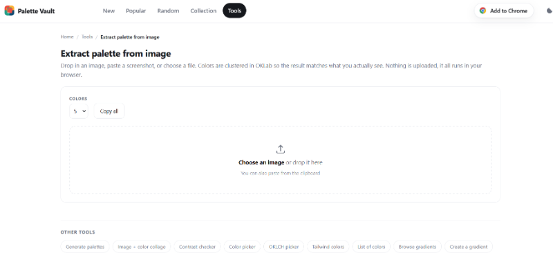

Another Friday, another batch of JavaScript and web development updates worth catching up on.

The ecosystem rarely slows down. Between framework releases, runtime improvements, browser changes, and new developer tools, there's always something interesting happening. Some updates bring features you can use immediately. Others offer a glimpse of where frontend development is heading.

In Friday Links #46, we're looking at the most interesting news, releases, articles, and tools from the past two weeks. Whether you work with JavaScript every day or just want to keep an eye on the ecosystem, there's plenty to explore.

Grab your coffee, open a few tabs, and let's get into it.

## 🧠 Language & Runtime Updates

[Node.js 26.13.0 Becomes LTS](https://nodejs.org/en/blog/release) - Node.js 26 received its LTS release, alongside Node.js 24.22.2. This is an important milestone for teams planning runtime upgrades and deciding which Node.js version to use in production.

[Node.js 27 Gets Its First Alpha](https://nodejs.org/en/blog/release) - The first Node.js 27 alpha build is available for early testing. It's a preview release rather than a production-ready runtime, but it gives developers a chance to evaluate upcoming changes.

[Vite 8.3 Receives New Patch Releases](https://vite.dev/releases) - Vite continues to receive updates in its 8.3 branch, while important fixes are also backported to supported older versions. The release tracker lists Vite 8.3.6.

[Rspack 2.3](https://rspack.rs/blog/announcing-2-3) adopts SWC Next’s rewritten parser, delivering 5–20% faster builds and lower peak memory usage.

## 🧩 Frameworks

[Next.js 16.4.5](https://nextjs-changelog.vercel.app/) addresses several security problems involving cached data, cross-user information disclosure, cache poisoning, SVG image optimization, and Edge runtime headers. An important update for applications using Cache Components and use cache.

[React Router 8.5.1 Arrives](https://github.com/remix-run/react-router/releases) - A maintenance update to React Router's 8.5 release line landed during the reporting period. Worth checking for projects already using React Router 8.

[Preact 11.1](https://github.com/preactjs/preact/releases/tag/11.1.0) adds React Compiler compatibility through the new `preact/compat/compiler-runtime` entry point.

[Astro Publishes Its October Ecosystem Roundup](https://astro.build/blog/whats-new-october-2026/)

[Nuxt 4.6.4 Released](https://github.com/nuxt/nuxt/releases) - Another maintenance release in the Nuxt 4 series, relevant to developers building Vue-based full-stack applications.

[NestJS 12.3](https://github.com/nestjs/nest/releases/tag/v12.3.0) introduces a native `node:http` adapter, allowing applications to run without Express or Fastify, alongside numerous bug fixes.

## 📜 Articles & Tutorials

[HTML-in-Canvas Arrives in Chrome 157](https://developer.chrome.com/blog/html-in-canvas)

[How To Corrupt An SQLite Database File](https://www.sqlite.org/howtocorrupt.html)

[Spreading Liquid with three.js](https://mofu-dev.com/en/blog/fluid-foundation/)

[Testing Frontend — Lessons from over a million lines of TypeScript at Palantir](https://www.meticulous.ai/blog/lessons-from-a-decade)

[How to make postMessage type-safe in under 350 bytes](https://evilmartians.com/chronicles/how-to-make-postmessage-type-safe-in-under-350-bytes)

[generating strings without parentheses in javascript](https://blog.ikaes.de/generating-strings-without-parentheses-in-javascript/)

[I Built a Visual System Design Reference — Switch Any Architecture Between AWS, Azure, GCP & Open Source](https://dev.to/amananandrai/i-built-a-visual-system-design-reference-switch-any-architecture-between-aws-azure-gcp-open-55og)

[How We Made clarity.js 4.5% Smaller Without Sacrificing Compatibility](https://clarity.microsoft.com/blog/how-we-made-clarity-js-smaller/)

[HTML-in-Canvas WebGL Demos](https://chrome.dev/html-in-canvas/)

[RAG vs Agentic RAG](https://blog.bytebytego.com/p/ep230-rag-vs-agentic-rag)

[Taming Typography: Building a Modern CSS Reset](https://css-tricks.com/taming-typography-modern-css-reset/)

[How the Claude Code team does code review](https://claude.dev/blog/solving-code-review-at-anthropic/)

## ⚒️ Tools

[Extract palette from image](https://palettevault.github.io/tools/extract/)

[webframe](https://github.com/tractordev/webframe) runs web pages as CLI programs using a hidden system web view, without Playwright or a bundled browser.

[ora 10](https://github.com/sindresorhus/ora) now requires Node.js 22 and improves spinner rendering by preserving surrounding terminal output.

[Loading UI](https://github.com/turbostarter/loading-ui) offers customizable spinners, loaders, and loading animations for React, easily installed via the shadcn CLI.

[drawably](https://github.com/danielwh2/drawably) creates animated, hand-drawn UI controls with randomized sketches, zero dependencies, and a tiny React wrapper.

[Browy](https://browyhq.github.io) adds an AI agent to Chrome’s side panel for browsing, filling forms, running JavaScript, capturing screenshots, and remembering context across sessions.

[React Trace](https://react-trace.js.org/) helps developers inspect React components, locate their source code, and debug rendering directly in the browser.

[zot](https://www.zot.sh) is a lightweight, Go-based terminal coding agent supporting multiple AI providers, with file editing and shell command execution.

[Apache Maka](https://github.com/apache/maka) is a high-performance AI agent workspace that maintains a complete record of every action for transparency and traceability.

[OpenFox](https://github.com/co-l/openfox) is a local-LLM-first coding assistant with tool execution, streaming responses, criteria tracking, and contract-driven workflows.

## 📚 Libs

[x18n](https://x18n.dev/) — Anthony Fu’s framework-agnostic i18n linter detects missing, unused, and invalid translation keys across locale files and code.

[Got 16.2](https://github.com/sindresorhus/got/releases/tag/v16.2.0) adds Standard Schema validation to `.json()`, enabling typed HTTP responses with Zod, Valibot, and ArkType.

[marked-terminal 8.0](https://github.com/mikaelbr/marked-terminal/releases/tag/v8.0.0) brings a TypeScript rewrite, a new `mt` CLI, and terminal image support via Kitty and iTerm2 graphics protocols.

[How to use TinyFish](https://flaviocopes.com/tinyfish/)

[Agent Scripts](https://github.com/steipete/agent-scripts) provides reusable AI agent instructions, skills, and lightweight scripts for automating development workflows.

## ⌚ Releases

[pnpm 12.17.0](https://pnpm.io/blog/releases/12.17.0) adds global peer dependency checks, wildcard overrides, and updates for Node.js, Cargo, and Python dependencies, plus Docker and installation fixes.

[Vitest 5.1](https://vitest.dev/blog/vitest-5-1) adds `--since-last-run` to rerun affected tests and an interactive snapshot review feature.

[Storyblok SDKs Add Editable Field Support](https://github.com/storyblok/monoblok/releases) - Storyblok updated its JavaScript framework SDKs to expose editableField across React, Vue, Svelte, Astro, Angular, and Nuxt integrations. This makes the update relevant to teams using Storyblok's visual editing workflow.

[Leaflet 2.0 Beta 1](https://github.com/Leaflet/Leaflet/releases/tag/v2.0.0-beta.1) brings tree-shaking, built-in TypeScript types, improved performance, and removes the default export.

[Shiki 4.6](https://shiki.style) improves syntax highlighting performance with faster decoration handling and a smaller Oniguruma WASM binary.

[Postgres.js 4.0](https://github.com/porsager/postgres/releases/tag/v4.0.0) brings a rewritten internals, ESM-only distribution, improved connection handling, and security fixes.

[Effect 4.1](https://effect.website/blog/releases/effect/41) adds new crypto APIs, glob-based file search, streaming CSV, standardized HTTP errors, and improved AI and MCP tooling.

[ESLint v10.14.0 released](https://eslint.org/blog/2026/10/eslint-v10.14.0-released/)

[Nuxt DevTools v4](https://nuxt.com/blog/devtools-v4)

[express-fileupload 1.6](https://github.com/richardgirges/express-fileupload/releases/tag/v1.6.0) fixes a ReDoS vulnerability in multipart `Content-Type` validation that could block the Node.js event loop.

[jsdom 31.0](https://github.com/jsdom/jsdom/releases/tag/v31.0.0) introduces a new CSS engine with nesting, cascade layers, and `@scope` support, switches to `@napi-rs/canvas`, and improves script parsing.

[fast-json-stringify 7.3](https://github.com/fastify/fast-json-stringify/releases/tag/v7.3.0) adds an optional native `JSON.stringify` fast path for Node.js 25+, delivering up to 2× faster serialization in benchmarks.

[Koa 3.3](https://github.com/koajs/koa/releases/tag/v3.3.0) improves security with safer query parsing and stricter HTTP header validation, alongside bug fixes and updated dependencies.

## 📺 Videos

[The worst week in cybersecurity history... so far](https://www.youtube.com/watch?v=k2ruCf_z75I)

[This Remote Desktop Works Even When My PC Is Off (JetKVM)](https://www.youtube.com/watch?v=jNFv1Lr2Db4)

[How Senior Developers Use AI to Build SaaS - Full Workflow](https://www.youtube.com/watch?v=-QCBtAfPHo0)

[Amazon built a new AI agent runtime in Rust](https://www.youtube.com/watch?v=os5eNeAVRpc)

[MCP Security Fundamentals Course](https://www.youtube.com/watch?v=gYXLRMycVMk)

[How Ethical Hackers Actually Break Into Systems](https://www.youtube.com/watch?v=cqfl38Ip1ho)

## 🗞️ News & Updates

### OpenAI Images 2.6 Brings GIF Creation and Faster Image Generation

OpenAI has introduced **Images 2.6**, bringing faster image generation and editing to ChatGPT, Codex, and the API. The update promises up to 50% faster generation and better consistency when editing characters, products, and branded visuals. ChatGPT is also gradually rolling out support for creating looping GIF animations from text prompts or uploaded images.

Another addition is **saved image references**, allowing users to reuse photos of people, pets, or characters across conversations without uploading them again. GIF creation focuses on short, looping animations rather than full video generation.

For developers, the API introduces **GPT-Image-2.6 Flare** for speed and **Sunburst** for higher-quality results. New capabilities include image editing with annotations, SVG output, and a `complexity` parameter for controlling how much planning goes into generating detailed scenes.

# Discord Is Replacing Electron and React Native with Rust

Discord is [rebuilding](https://x.com/svishnevskiy/status/2118081920194203799) its desktop and mobile apps in **Rust**, moving away from Electron and React Native. The new desktop client, codenamed **Discord Phoenix**, will use GPUI, the GPU-accelerated UI framework developed for the Zed editor, while embedded web content will run through the system WebView.

On iOS and Android, Discord plans to use native interfaces backed by shared Rust code. The browser version will continue rendering HTML, with application logic running through WebAssembly. The company is also working on a native Linux client.

According to Discord CTO Stanislav Vishnevskiy, an early Phoenix build used just **290 MB of RAM** with two accounts active. User testing is expected to begin soon, although no public release date has been announced.

### Chrome 157 Highlights New Web APIs

[A new Chrome 157 feature](https://web-standards.dev/news/2026/11/chrome-157/) overview covers HTML-in-canvas, the CSS corner shorthand, custom text-overflow strings, and HTML streaming methods.

### GitHub Agentic Workflows Become Generally Available

[GitHub's agentic workflows reach general availability](https://github.blog/changelog/), bringing AI-assisted automation into repository workflows. Developers can use agents for tasks that extend beyond conventional scripted CI jobs.

GitHub’s [Octoverse 2026 report](https://github.blog/news-insights/octoverse/octoverse-commits-pushes-reach-new-highs-in-2026-as-developers-build-with-agents/) ranks TypeScript as its most-used language, with JavaScript third. AI was involved in roughly 44% of merged TypeScript PRs.

Cloudflare Workers [now supports the Temporal API](https://developers.cloudflare.com/workers/configuration/compatibility-flags/#enable-the-temporal-api) behind the temporal flag, with default support starting December 1.

---

That's a wrap for Friday Links #46.

As usual, the JavaScript ecosystem has given us plenty to read, experiment with, and occasionally rethink. You don't need to try every new library or upgrade the moment a release lands. Sometimes the most useful thing is simply knowing what's changing and what might be worth revisiting later.

Found an interesting project, article, or release that deserves a spot in the next issue? Feel free to share it.

Thanks for reading, and see you next Friday for another roundup of JavaScript and web development links.

Happy coding!
