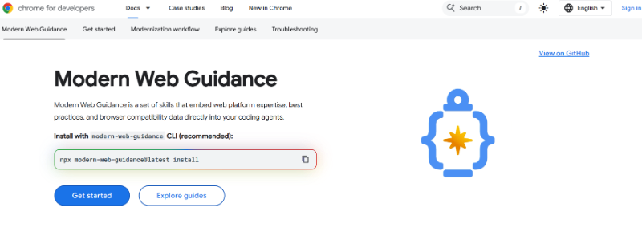
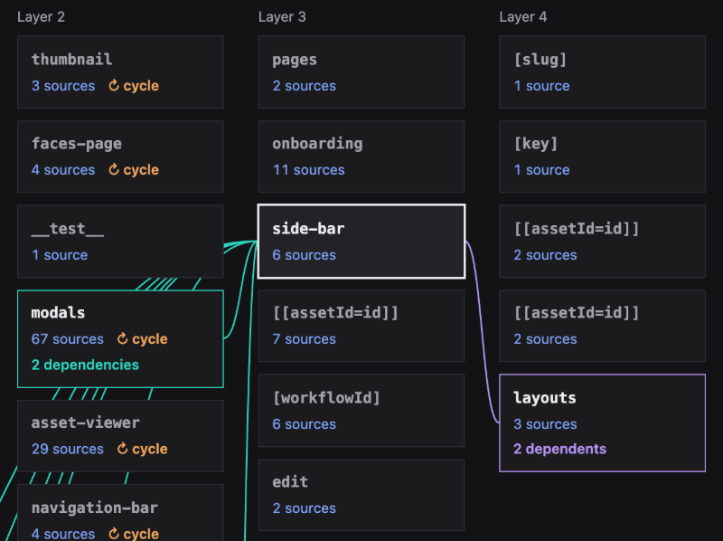
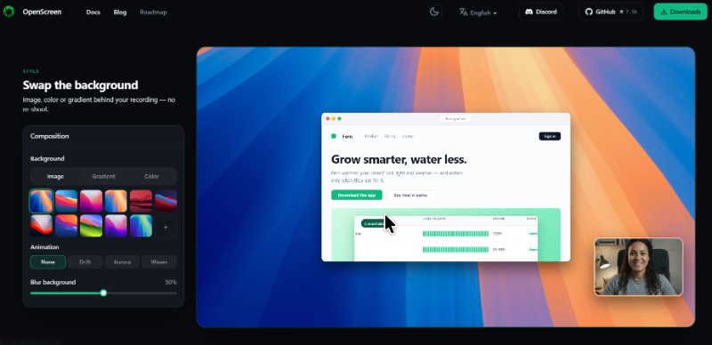

Welcome back to Friday Links, your weekly dose of JavaScript and web development news.

The web ecosystem never stands still. Between framework updates, new developer tools, experimental browser features, and fresh approaches to familiar problems, there's always something worth exploring.

In this edition, I've put together a selection of recent releases, useful open-source projects, interesting articles, and updates from across the JavaScript ecosystem.

Grab a drink, get comfortable, and let's see what's new.

## Modern Web Guidance Reaches Version 1.0



### **Modern Web Guidance Reaches Version 1.0**

[Modern Web Guidance](https://developer.chrome.com/docs/modern-web-guidance) is now officially stable, with the Firefox and Microsoft Edge teams joining the initiative. The project helps AI coding agents build better web applications using modern web standards and best practices.

Here's what's new:

- **Over 200 guides.** The collection now covers accessibility, performance, security, forms, and other essential frontend topics.
- **Baseline-powered browser compatibility.** Agents receive browser support information and fallback recommendations, including `@supports` and polyfills. According to the team's benchmarks, the success rate for handling unsupported features increased from 43% to 87% when using the skill.
- **Lightweight local search.** Instead of loading every guide into the context window, agents retrieve only the relevant information. The team also reworked the search engine, reducing the package size from 507 MB to approximately 7 MB.
- **Existing codebase analysis.** The skill can identify certain outdated patterns and recommend modern alternatives. The number of available checks is still limited, but it's already worth trying on existing projects.

To get started, run:

```
npx modern-web-guidance@latest install
```

Modern Web Guidance is a promising step toward AI-generated frontend code that follows current web standards rather than relying on outdated patterns.

## 🧠 Language & Runtime Updates

[Node.js 27 Enters Alpha](https://github.com/nodejs/node/releases/tag/v27.0.0-alpha.0.1.1) - An early Node.js 27 alpha build has been published, giving developers an opportunity to experiment with the next major runtime version.

As an alpha release, it is intended for testing and feedback rather than production workloads.

### webpack Adds Native CSS and HTML Support

webpack is expanding its built-in capabilities with [native support for CSS and HTML](https://webpack.js.org/blog/2026-11-16-css-and-html-are-built-in/), potentially reducing the need for additional loaders and plugins in common build configurations.

The change aims to simplify application setup and make working with standard web assets more straightforward.

## 🧩 Frameworks

### Solid 2.0: Native Async Reactivity and a Simpler API

[Solid 2.0](https://www.solidjs.com/blog/solid-2-0-the-long-hold/) has officially reached stable after five years of development. The release introduces a rewritten reactive core, native asynchronous reactivity, built-in server functions, and a significantly smaller API surface.

Key changes include:

- **Native async reactivity.** Reactive computations now support Promises and async iterators directly, with automatic handling of race conditions and coordinated updates.
- **Optimistic updates.** Built-in optimistic actions with automatic rollback and reconciliation with server data.
- **Server functions.** Native support for RPC, real-time streaming, and persistent connections through Server-Sent Events (SSE).
- **AI-friendly diagnostics.** Detailed runtime errors with source locations, suggested fixes, and repair instructions for AI coding agents.
- **Improved observability.** Detection of request waterfalls, effect loops, and inefficient reactive graphs, alongside integrations with Chrome Performance Tracks and Sentry.
- **Simplified API.** Removed `createResource`, `batch`, `startTransition`, `on`, `produce`, `createComputed`, and `createMutable`.
- **SolidStart retirement.** Its foundational capabilities are now provided by Solid core and framework-agnostic Vite plugins.
- **Experimental syntax support.** ReactiveScript and TSRX aim to improve AI-assisted development through compiler-driven abstractions.

Solid 2.0 also improves integration with third-party solutions such as TanStack Query and TanStack Router.

The release follows 23 release candidates, 971 merged pull requests, and 753 closed issues over 14 weeks.

Get started with `npm create solid@latest`.

[e18e Framework Performance Project](https://e18e.dev/blog/launching-the-framework-performance-project/) - An ongoing benchmarking initiative comparing JavaScript meta-frameworks like Nuxt, Astro, SvelteKit, and SolidStart. Tracks install size, build times, rendering performance, and more, with results available on an [interactive dashboard](https://frameworks.e18e.dev/).

## 📜 Articles & Tutorials

[Inside the Codex sandbox](https://openai.com/index/inside-the-codex-sandbox/)

[PostgreSQL in Docker for Production: Volumes, Shared Memory, Pooling & Backups](https://www.alekseialeinikov.com/en/blog/topics/data/postgresql-in-docker-production)

[The Agentic Loop Explained: Step Through the Plan, Build, Judge and Repeat Loop Behind AI Coding Agents](https://dev.to/devopsdaily/the-agentic-loop-explained-step-through-the-plan-build-judge-and-repeat-loop-behind-ai-coding-36g)

[Introducing Frostbite: A new CPU architecture discovered, designed, and verified end-to-end by AI](https://architectlabs.com/blog/frostbite)

[Introducing the World's Strongest Sokoban Solver](https://healeycodes.com/introducing-the-worlds-strongest-sokoban-solver)

[AI Came for the Coders. Understanding Why Tells Us Who’s Next](https://www.robertpeake.com/archives/104254-ai-came-for-the-coders-understanding-why-tells-us-whos-next.html)

[It's all about the allocator](https://aarol.dev/posts/zig-allocator/)

## ⚒️ Tools

### Galactica: Visualize Your JavaScript and TypeScript Codebase



[Galactica](https://github.com/cognitap/galactica?utm_source=chatgpt.com) is an open-source codebase visualization tool designed for developers and AI coding agents. It maps import relationships across JavaScript and TypeScript repositories, making complex codebases easier to navigate and understand.

Explore interactive dependency graphs in a standalone HTML file or use the CLI to analyze the impact of code changes and identify affected tests.

The tool also detects circular dependencies, traces import chains, and integrates with Codex, Claude Code, and Cursor. It requires Node.js 24.1 or newer.



[OpenScreen](https://github.com/getopenscreen/openscreen) - A free, open-source screen recorder and video editor for creating polished product demos. Features AI-powered editing, automatic cursor zooms, offline transcription, webcam overlays, and GPU-accelerated exports. Includes a CLI and AI agent integration for automating demo creation, with no watermarks or subscriptions.

[Secretlint 14](https://github.com/secretlint/secretlint/releases/tag/v14.0.0) - A linter that detects API keys, tokens, and other exposed secrets before they reach your repository. Particularly useful when AI coding agents handle commits. Easy to get started with a single `npx` command.

[Kitesurf](https://blog.cloudflare.com/kitesurf-open-source/) - Cloudflare has open-sourced its experimental browser engine built for AI agents. Mostly written in TypeScript, it runs JavaScript in V8 isolates on Workers and uses Rust compiled to WebAssembly for rendering. No Chromium required, and it supports Puppeteer automation.

## 📚 Libs

[OpenSubs](https://opensubs.app) is an open-source alternative to VEED and Kapwing for AI-powered automatic video subtitles. It features local Whisper speech recognition, animated subtitle styles, multilingual translation, and watermark-free MP4 exports. Built with TypeScript, Rust, and WebAssembly, it processes videos locally without uploading them to external servers. Available as a web app, browser extension, desktop application, and CLI. [GitHub](https://github.com/open-subs/opensubs).

[Ding](https://ding.yusufcengiz.dev/): spring-physics toast notifications

[Pin UI](https://www.pinui.xyz/) - A free, open-source collection of animated, accessible React components inspired by Pinterest designs. Includes light and dark themes, responsive page sections, and easy installation via the shadcn CLI. Built with React, CSS, and Motion.

[OpenBot 1.0](https://github.com/CopilotKit/openbot) - A free, open-source alternative to Grok Bot that you can fully customize and adapt to your own needs.

[islandcn](https://islandcn.dev/) - An open-source React library that brings Apple's Dynamic Island-style interactions to the web. Includes animated presets for uploads, timers, calls, music, and more, with support for simultaneous activities and fully customizable components.

[NVIDIA SkillEvaluator](https://github.com/NVIDIA/SkillEvaluator) - An open-source framework for testing and benchmarking AI agent skills. Features automated quality checks, duplicate detection, and sandboxed evaluations that compare agent performance with and without a skill. Integrates with CI pipelines, Claude Code, and Codex.

[Mediabunny 1.66](https://github.com/Vanilagy/mediabunny/releases/tag/v1.66.0) - The media processing toolkit for browsers and Node.js gets over 400 fixes and improvements following an extensive [AI-assisted code audit](https://github.com/Vanilagy/mediabunny/pull/636). The update improves reliability, media format compatibility, and tree shaking.

## ⌚ Releases

### Vercel Introduces UI SDK

[Vercel has introduced UI SDK](https://ui-sdk.dev/docs/core/changelog/introducing-ui-sdk), a collection of headless behavioral primitives designed to help AI agents assemble interactive user interfaces.

Instead of generating every component from scratch, agents can build on reusable interaction patterns, potentially making AI-generated interfaces more consistent and maintainable.

### React Flow 13

[React Flow](https://reactflow.dev/) has received a major update, continuing the development of its toolkit for building interactive diagrams, node-based editors, and visual workflows.

The library is particularly relevant for applications involving AI agent orchestration, workflow builders, and complex visual interfaces.

[React Virtualized 10](https://github.com/bvaughn/react-virtualized) is another major release highlighted this week. The library helps React applications efficiently render large collections of data by displaying only the elements needed for the current viewport.

Virtualization remains an important technique for building responsive tables, dashboards, and data-heavy interfaces.

[Fate 2.0](https://fate.technology/posts/whats-new-in-fate-2.0) was also mentioned among the week's notable frontend releases. The new major version represents another update in the JavaScript tooling ecosystem.

[Immich 3.4](https://github.com/immich-app/immich/releases/tag/v3.4.0) is out with JPEG XL support, mobile photo tagging, smoother timeline navigation, and improved automation workflows with EXIF and OCR-based filters. The open-source, self-hosted alternative to Google Photos also introduces faster album loading, optimized memory usage, improved backups, and 16 security fixes, including a stricter Content Security Policy (CSP).

[Prettier 3.10](https://prettier.io/blog/2026/11/11/3.10.0) - Adds support for the latest JavaScript proposals and new Flow syntax, along with an optional plugin that uses the Zig-powered [Yuku](https://yuku.fyi/) parsers to speed up JavaScript and TypeScript formatting.

[p5.js 2.4](https://github.com/processing/p5.js/releases/tag/v2.4.0) - Expands SVG and 3D model support in the popular creative coding library, making it easier to experiment with interactive graphics. There's also a [starter sketch](https://openprocessing.org/@p5js/3047798) to help you jump right in.

[ws 8.23](https://github.com/websockets/ws/releases/tag/8.23.0) - The popular WebSocket library for Node.js fixes a denial-of-service vulnerability that could exhaust server memory by flooding connections with Ping frames. The update also adds a `maxPendingAutoPongs` option to limit queued Pong responses.

[PostgreSQL 19 Released](https://www.postgresql.org/docs/release/19.0/)

[semantic-release 26](https://github.com/semantic-release/semantic-release/releases/tag/v26.0.0) - The automated versioning and publishing tool now requires Node.js 26.13+ and upgrades to npm 12. Also introduces stricter branch synchronization checks and improvements to release automation.

[SlickGrid 6.0](https://github.com/6pac/SlickGrid) - The long-standing JavaScript data grid library now has zero dependencies, four-sided row and column pinning, sticky rows and columns, and improved performance. Check out the [interactive examples](https://6pac.github.io/SlickGrid/).

[Vim Classic 8.3.1 Released](https://vim-classic.org/news/vim-8.3.1-released.html)

[XState v6 Beta](https://stately.ai/blog/2026-11-05-xstate-v6-beta) - The state machine and actor library's next major release enters beta with a stable core API. Available to try now via `xstate@beta`.

[Excalibur 1.0](https://excaliburjs.com/blog/excalibur-1-0-0-released) - After 13 years of development, the TypeScript 2D game engine reaches its first stable release, adding 2D lighting, a plugin API, and a revamped Web Audio mixer. Explore the [sample games](https://excaliburjs.com/samples).

[JSNES 3.0](https://github.com/bfirsh/jsnes/releases/tag/v3.0.0) - The JavaScript NES emulator gets a cycle-accurate core that passes all 134 AccuracyCoin tests, improving emulation accuracy while maintaining performance. Try the [playable demos](https://jsnes.org/).

[type-fest 6.0](https://github.com/sindresorhus/type-fest/releases/tag/v6.0.0) - The popular TypeScript utility type collection adds 120 new types, performance improvements, and numerous fixes. Now requires TypeScript 6 and Node.js 22+.

[Fontkit 3.0](https://github.com/foliojs/fontkit) - The font processing engine for Node.js and browsers moves to ESM, adds optimized platform-specific builds, and introduces a modular `core` export to reduce bundle size.

[dts-bundle-generator 10.0](https://github.com/timocov/dts-bundle-generator/releases/tag/v10.0.0) - The TypeScript declaration bundler moves to ESM, adds TypeScript 6 support, and improves performance on large projects. Now requires Node.js 24+.

[nano-spawn 3.0](https://github.com/sindresorhus/nano-spawn/releases/tag/v3.0.0), [quick-lru 8.0](https://github.com/sindresorhus/quick-lru/releases/tag/v8.0.0), [debounce 4.0](https://github.com/sindresorhus/debounce/releases/tag/v4.0.0), and [crypto-hash 5.0](https://github.com/sindresorhus/crypto-hash/releases/tag/v5.0.0) - Four popular utilities by Sindre Sorhus receive major updates with bug fixes, API improvements, and a new minimum requirement of Node.js 22.

[nvm 0.41](https://github.com/nvm-sh/nvm/releases/tag/v0.41.0) - The Node.js version manager adds support for the new `alpha` release channel, improves version selection, and excludes alpha builds by default.

[onvif 1.1](https://agsh.github.io/onvif/) - A Node.js client library for discovering and controlling ONVIF-compatible IP cameras, including access to device information, video streams, and camera controls.

## 📺 Videos

[Claude Opus 5.5: Anthropic's Official Prompting Guide Explained](https://www.youtube.com/watch?v=3Z7xokWxFRE)

[CSS can tell you what's broken](https://www.youtube.com/watch?v=zXAXpMYnJV8)

[The Algorithm That Generates Infinite Worlds](https://www.youtube.com/watch?v=dUgVoS1NYws)

[How WebSockets Work: Build Real-Time Apps Like a Senior Engineer](https://www.youtube.com/watch?v=Ee2OPfmcWBQ)

[Functional Requirements in System Design Interviews: 5-Step Method](https://www.youtube.com/watch?v=2M-toJuKlYY)

[10 cybersecurity terms to prepare you for the age of AI](https://www.youtube.com/watch?v=THtxqKwQdw4)

[n8n Tutorial: Second Brain With AI Agents & Memory](https://www.youtube.com/watch?v=4lEVI0E5XHw)

## 🗞️ News & Updates

### Optimizely Supply Chain Attack Injects Malicious JavaScript into 178 Organizations

A JavaScript supply chain attack targeting Optimizely, a popular A/B testing and website personalization platform, exposed visitors to websites belonging to BBC, CNN, Zoom, GitLab, Salesforce, IKEA, and other major organizations to malicious code.

On November 16, security researchers at Report URI discovered malicious JavaScript in 188 of 1,611 analyzed Optimizely scripts, affecting at least 178 organizations.

Attackers exploited a vulnerability in Optimizely Experimentation that allowed them to inject malicious code into customer projects through the platform's Project JavaScript feature.

Since the compromised scripts were served over HTTPS from the legitimate `cdn.optimizely.com` domain, the attackers could distribute malware without compromising each website individually.

The malicious JavaScript had several capabilities:

- **Cryptocurrency theft.** Replaced legitimate wallet addresses with attacker-controlled alternatives across page content, forms, clipboard data, and certain outgoing requests.
- **Payment data interception.** Collected credit card numbers, expiration dates, and CVV codes by monitoring form submissions and network requests.
- **Cookie theft and screenshots.** Captured accessible cookies, page URLs, and screenshots using `html2canvas`.
- **iOS exploitation.** Attempted to target iPhones and iPads using the Coruna and DarkSword exploit kits, although successful device compromises have not been confirmed.

During the attack, the malicious payload was updated 26 times. Researchers identified approximately $7,040 in cryptocurrency transactions associated with the attack, though the full extent of the damage remains unknown.

Optimizely confirmed the incident, patched the vulnerability, removed the injected code, revoked access tokens, and notified affected customers.

**Why this matters for web developers**

The incident highlights one of the biggest risks of third-party JavaScript. External scripts can execute with access to sensitive page content, even when your own application infrastructure has not been compromised.

According to Report URI, only 24 of 256 examined affected hosts had sufficiently restrictive Content Security Policy configurations to block relevant parts of the attack.

A carefully configured CSP, monitoring third-party script changes, isolating sensitive payment interfaces, and auditing external network requests can help reduce these risks.

The biggest takeaway? A trusted domain, a valid HTTPS certificate, and a reputable service provider do not guarantee that the JavaScript running on your website is safe.

**Sources:** [Report URI](https://report-uri.com), [BleepingComputer](https://www.bleepingcomputer.com), [Optimizely Status](https://status.optimizely.com).

[Google Introduces Gemini 4 Neon](https://blog.google/innovation-and-ai/models-and-research/gemini-models/introducing-gemini-4-neon/) - Google has launched a new frontier AI model designed to balance advanced reasoning, coding performance, speed, and cost. Positioned between Gemini 4 Carbon and the faster Hydrogen, Neon targets complex software engineering, agentic workflows, and analytical tasks. It ranks third on the Artificial Analysis Intelligence Index and second on the Vals Index. Google reports 32% lower cost per task than Carbon at the default high reasoning level. The model supports a 1-million-token context window and costs $3 per million input tokens and $15 per million output tokens. It's rolling out through the Gemini API, Google AI Studio, Antigravity, and the Gemini app for eligible subscribers.

### Malicious npm Package Steals Crypto Wallet Keys During Installation

Security researchers have identified a supply chain attack involving version 13.3.0 of `@ethersphere/bee-js`, a JavaScript library for the decentralized Swarm storage network.

The compromised package was distributed through the project's legitimate GitHub Actions publishing workflow, making its npm build provenance appear trustworthy despite malicious code already being present in the repository.

The malware executes during dependency installation, before the application even starts. Disguised as analytics functionality, it downloads and executes remote JavaScript with the permissions of the user installing the package.

Its main capabilities include:

- Stealing encrypted cryptocurrency wallet keys and configuration files.
- Attempting to establish persistent access to compromised systems.
- Installing a remote-access backdoor on Linux and macOS.
- Using an Ethereum smart contract to dynamically locate its command-and-control server.

The compromised package could also be installed as a transitive dependency, putting projects at risk even if they do not explicitly include `bee-js` in their `package.json`.

Developers using Swarm-related tools should inspect their lockfiles, package caches, and CI installation logs for version 13.3.0.

If the affected version was installed with lifecycle scripts enabled, or Swarm Desktop 0.56.2 was executed, the environment should be treated as potentially compromised. This includes reviewing CI credentials, npm publishing tokens, and source code access.

The incident is another reminder that official repositories, automated release pipelines, and verified package provenance do not necessarily guarantee software integrity.

**Sources:** [Socket](https://socket.dev/blog/bee-js-compromise), [SafeDep](https://safedep.io/blog/ethersphere-bee-js-npm-compromise), [GitHub commit](https://github.com/ethersphere/bee-js/commit/de2f74e784b2eafa0d66fbb6d88b42ea11ee34cf).

## 🤖 AI 

### OpenAI Releases GPT-6.2 Astra and Sol

OpenAI has introduced GPT-6.2 Astra and Sol, with the latter arguably being the more interesting release.

On the FrontierCode 2.0 benchmark, Sol nearly matches Astra's performance while costing roughly five times less per task. The benchmark evaluates whether changes made by AI coding agents are good enough to be merged into real-world repositories.

- **GPT-6.2 Sol:** 43.8%
- **GPT-6.2 Astra:** 44.2%
- **Claude Opus 5.5:** 45.5%
- **Claude Fable 5.2 (xhigh):** 49.1%

The broader [Artificial Analysis Intelligence Index](https://artificialanalysis.ai/leaderboards/models) tells a slightly different story. Astra scores 62 points, ahead of Opus 5.5 at 59 but behind Fable 5.2 at 65.

API pricing per million tokens (input/output):

- **GPT-6.2 Astra:** $8 / $40
- **GPT-6.2 Sol:** $2 / $10

Astra is now 20% cheaper than its predecessor, while Sol's pricing remains unchanged.

Both models are available in Codex, ChatGPT Work, and the API. Additionally, subscribers to the $200 ChatGPT Pro plan can now enable Ultrafast mode for Sol, a feature previously reserved for the $500 personal subscription.

For developers working with AI coding agents, Sol could be the sweet spot between performance and cost.

### Google Introduces Gemini 4 Hydrogen

Google is expanding its Gemini 4 lineup with two models designed for different workloads: Carbon, released on November 10, and Hydrogen, introduced on November 12.

**Gemini 4 Carbon** is Google's most powerful model for complex, long-running tasks, including software architecture, large-scale migrations, advanced debugging, and multi-agent workflows. It dedicates more tokens to reasoning and verification.

**Gemini 4 Hydrogen** focuses on speed and everyday development tasks, such as writing code, running tests, fixing bugs, and building interfaces.

The two models can also work together. Carbon can handle architectural decisions and coordinate tasks, while Hydrogen-powered agents implement and verify changes in parallel.

To support this workflow, Google introduced **Orchestrator** in Antigravity, which dynamically switches between models within a single session.

According to Google, Orchestrator achieved comparable results to Carbon on Terminal-Bench 4.0 while consuming 24% less quota and completing tasks 19% faster.

**API pricing per million tokens (input/output):**

- **Gemini 4 Carbon:** $2 / $10 (introductory pricing)
- **Gemini 4 Hydrogen:** $1.50 / $7.50

Hydrogen also offers four reasoning levels, ranging from `low` to `xhigh`, allowing developers to balance speed, computational cost, and reasoning depth.

Hydrogen is available through Gemini, Google AI Studio, and the Gemini API, including free tiers. Antigravity users can access it through Google AI Pro and Ultra subscriptions.

Carbon is available to paid API developers and is gradually rolling out to Ultra subscribers in Gemini and Antigravity.

Rather than relying on a single powerful model for everything, Google's approach focuses on combining specialized models to balance performance, speed, and cost.

Read more: [Gemini 4 Carbon](https://blog.google/innovation-and-ai/models-and-research/gemini-models/gemini-4-carbon-now-available/)

### Anthropic Releases Claude Fable 5.2 and Mythos 5.2

Anthropic has introduced Claude Fable 5.2 and Mythos 5.2, bringing improvements in coding, reasoning, and image understanding. According to the company, the new models generate responses up to 30% faster than their predecessors.

Several development experiments stand out:

- **Python to Rust migration.** Fable 5.2 helped migrate one of Anthropic's production services from Python to Rust, reportedly reducing startup time by a factor of 26.
- **An operating system built by AI agents.** In another experiment, Fable coordinated more than 1,000 subagents over eight days to build a prototype operating system. The result was a bootable OS with drivers, file storage, a windowing system, and an installer.
- **Improved coding performance.** Fable 5.2 scored 49.1% on FrontierCode 2.0 at the `xhigh` effort level, compared to 32.4% for Fable 5.1 and 45.5% for Opus 5.5.

**API pricing per million tokens (input/output):**

- Standard mode: $8 / $40
- Fast mode: $16 / $80, with up to 2.5 times faster generation.

Anthropic still recommends starting with Opus 5.5 for most everyday tasks and bringing in Fable when additional reasoning or coordination is needed.

Fable could be particularly valuable as a technical advisor to other models or as an orchestrator for teams of autonomous coding agents working on complex software projects.

[Read the official announcement](https://www.anthropic.com/claude-fable-and-mythos-5-2)

[Anthropic's blockbuster debut tests Wall Street's faith in AI boom](https://www.reuters.com/business/finance/anthropics-historic-debut-put-ais-promise-peril-wall-st-test-2026-11-19/)

---

That's a wrap for Friday Links #47.

Hopefully, you've discovered something useful, whether it's a new library to try, a tool that makes your workflow easier, or an article worth saving for later.

If you enjoyed this roundup, consider subscribing and sharing it with your fellow developers. Found something interesting that deserves a spot in the next edition? Feel free to leave a comment.

Thanks for reading, have a great weekend, and see you in the next Friday Links!