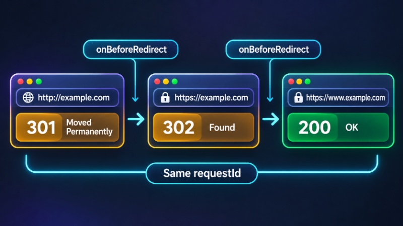
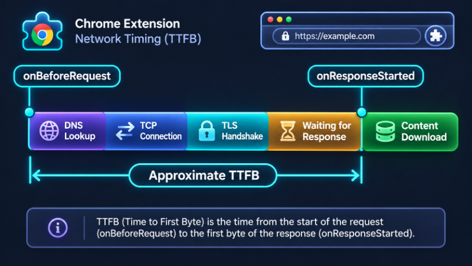
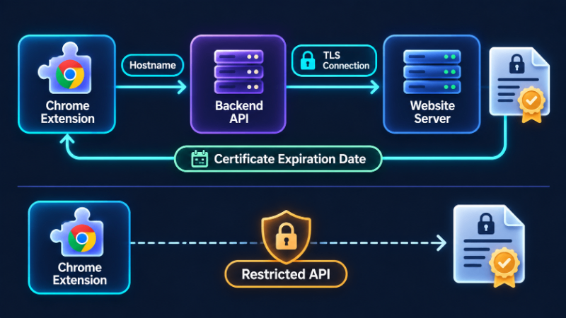
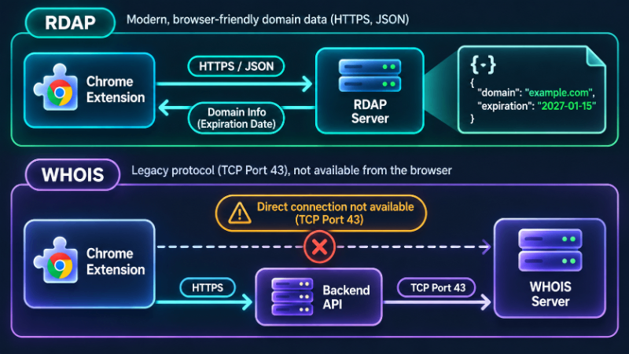
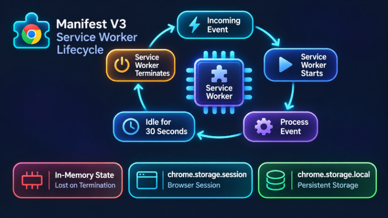
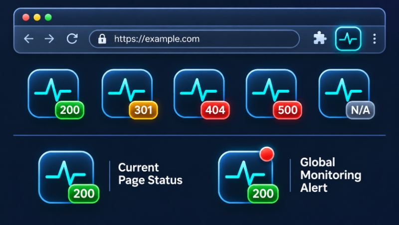
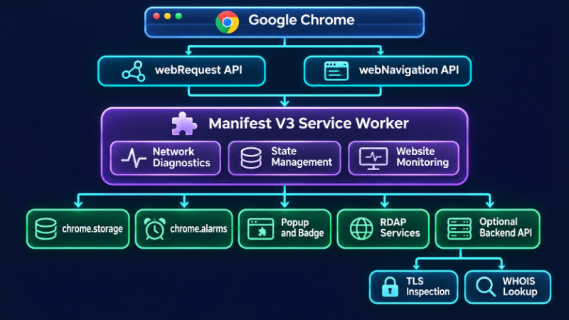

Building a Chrome extension that displays information about the current website sounds like a relatively straightforward project.

Imagine an extension that shows the HTTP status code directly on its toolbar icon. Clicking the icon opens a panel with the redirect chain, response time, SSL certificate expiration date, and domain registration details. Add periodic availability checks, and you have a useful diagnostic tool for web developers.

Chrome already provides APIs for observing network requests, tracking navigation, managing background tasks, and interacting with browser tabs. In theory, everything needed is already there.

In practice, things get more complicated.

Some network requests are invisible to extensions. Access to SSL certificates is restricted. Domain expiration data depends on external services, and background service workers can shut down after just 30 seconds of inactivity.

If you want to build a website monitoring extension using Manifest V3, here is what you need to know before designing its architecture.

## 1. Tracking HTTP Status Codes and Redirects

The `chrome.webRequest` API allows extensions to observe HTTP requests, including those responsible for loading the main document.

Manifest V3 restricts the ability of most extensions to intercept and modify requests synchronously, but passive network observation remains available. For a monitoring extension, that is usually enough.

Start by filtering requests to include only top-level page navigations:

```js
const MAIN_FRAME = {
  urls: ["http://*/*", "https://*/*"],
  types: ["main_frame"],
};
```

The `onHeadersReceived` event provides access to HTTP response status codes, while `onBeforeRedirect` exposes the destination of a server-side redirect.

```js
const requests = new Map();

function getRedirectChain(requestId) {
  if (!requests.has(requestId)) {
    requests.set(requestId, []);
  }

  return requests.get(requestId);
}

chrome.webRequest.onHeadersReceived.addListener(
  (details) => {
    getRedirectChain(details.requestId).push({
      url: details.url,
      status: details.statusCode,
      redirectTo: null,
    });
  },
  MAIN_FRAME
);

chrome.webRequest.onBeforeRedirect.addListener(
  (details) => {
    const chain = getRedirectChain(details.requestId);
    const last = chain.at(-1);

    if (last?.url === details.url && !last.redirectTo) {
      last.redirectTo = details.redirectUrl;
    } else {
      chain.push({
        url: details.url,
        status: details.statusCode,
        redirectTo: details.redirectUrl,
      });
    }
  },
  MAIN_FRAME
);
```

Chrome uses the same `requestId` throughout a server-side redirect chain. This makes it possible to reconstruct a sequence of HTTP responses.



In this example, the browser follows two server-side redirects—`301` and `302`—before receiving the final `200` response.

In a production extension, completed and failed requests should also be removed from the map. More importantly, any state that needs to survive service worker termination must be stored outside global variables.

### Server-Side vs. Client-Side Redirects

Not every redirect is an HTTP redirect.

A website can navigate to another URL using JavaScript:

```js
window.location.replace("/dashboard");
```

Or through an HTML meta tag:

```html
<meta http-equiv="refresh" content="0; url=/dashboard">
```

From the perspective of `webRequest`, these are separate navigations rather than steps in the same HTTP redirect chain.

To detect them, use the `chrome.webNavigation` API.

```js
chrome.webNavigation.onCommitted.addListener((details) => {
  if (details.frameId !== 0) return;

  const isClientRedirect =
    details.transitionQualifiers.includes("client_redirect");

  if (isClientRedirect) {
    console.log("Client-side redirect:", details.url);
  }
});
```

Combining both APIs provides a more complete picture of how the browser reached the current page.

There are still two important edge cases.

A cached redirect may trigger `onBeforeRedirect` without a preceding `onHeadersReceived` event. Meanwhile, an HTTP-to-HTTPS upgrade through HSTS can appear as a `307 Internal Redirect`.

Unlike a regular HTTP 307 response, an internal HSTS redirect does not represent a response from the remote server. The browser upgrades the connection before contacting the website.

A good diagnostic extension should distinguish between these events.

## 2. Measuring Response Time Without Content Scripts

A content script with the Performance API might seem like the obvious solution for measuring response time.

However, `webRequest` events already contain timestamps. For basic network timing, injecting JavaScript into every page is unnecessary.

```js
const requestStartTimes = new Map();

chrome.webRequest.onBeforeRequest.addListener(
  (details) => {
    if (!requestStartTimes.has(details.requestId)) {
      requestStartTimes.set(
        details.requestId,
        details.timeStamp
      );
    }
  },
  MAIN_FRAME
);

chrome.webRequest.onResponseStarted.addListener(
  (details) => {
    const start = requestStartTimes.get(details.requestId);

    if (start === undefined) return;

    const responseTime = details.timeStamp - start;

    console.log({
      url: details.url,
      status: details.statusCode,
      responseTime: Math.round(responseTime),
    });
  },
  MAIN_FRAME
);

function cleanupRequest(details) {
  requestStartTimes.delete(details.requestId);
}

chrome.webRequest.onCompleted.addListener(
  cleanupRequest,
  MAIN_FRAME
);

chrome.webRequest.onErrorOccurred.addListener(
  cleanupRequest,
  MAIN_FRAME
);
```

The difference between the initial request timestamp and `onResponseStarted` provides an approximation of the time to the first response byte.



This measurement may include connection establishment, redirects, and other browser-side delays. It should not be presented as pure server processing time.

The main advantage is architectural simplicity. No injected scripts, fewer permissions, and less code running inside websites.

## 3. The Blind Spots of Chrome Network Monitoring

Even with `webRequest` and `webNavigation` working together, an extension cannot observe everything happening inside the browser.

Several browser optimizations make network monitoring surprisingly complicated.

### Memory Cache and Back/Forward Cache

Chrome does not necessarily make a new HTTP request every time a page appears on the screen.

When a document is restored from the back/forward cache, commonly known as bfcache, the browser can restore the entire page without contacting the server.

There may be no new `webRequest` events. Even `DOMContentLoaded` does not fire again when a document is restored from bfcache.

Displaying a previously recorded HTTP 200 response as if it were a fresh network result would be misleading.

A better interface could show:

- `200` for a newly observed successful response.
- `Cached` for a known cached result.
- `N/A` when no current network response is available.

### Website Service Workers

A website can register its own service worker and intercept requests before they reach the network.

```js
self.addEventListener("fetch", (event) => {
  event.respondWith(
    caches.match(event.request).then((cached) => {
      return cached || fetch(event.request);
    })
  );
});
```

If a response comes directly from the website's service worker cache, the extension may not observe a corresponding network request.

Progressive web applications make this scenario particularly common.

### Single-Page Applications

React, Vue, Angular, and other client-side frameworks frequently change the current URL without loading a new HTML document.

```js
history.pushState({}, "", "/settings");
```

The address changes, but there is no new HTTP response for the document.

Chrome provides a dedicated navigation event for this situation:

```js
chrome.webNavigation.onHistoryStateUpdated.addListener(
  (details) => {
    if (details.frameId !== 0) return;

    console.log("SPA navigation:", details.url);
  }
);
```

An extension should distinguish between a document-level HTTP status and the current client-side route.

### Prerendering

Chrome can load a page before the user actually navigates to it.

Events that expose document lifecycle information can help distinguish between prerendered and active documents.

```js
if (
  details.documentLifecycle &&
  details.documentLifecycle !== "active"
) {
  return;
}
```

The `webNavigation.onTabReplaced` event can also help handle situations where a prerendered page replaces an existing tab.

One additional complication is that Chrome does not guarantee the relative ordering of `webRequest` and `webNavigation` events.

Avoid designing the extension around assumptions such as one navigation event always arriving before a network event. Independent event handlers and properly correlated state make the implementation more reliable.

## 4. Accessing SSL Certificates: An API You Cannot Rely On

Checking SSL certificate expiration seems like a natural feature for a website monitoring extension. Chrome establishes the TLS connection, validates the certificate, and already knows its expiration date.

Unfortunately, exposing this information to extensions is another matter.

Since Chrome 144, the `webRequest` API schema has described a `securityInfoRawDer` option that provides access to certificates encoded in DER format.

```js
chrome.webRequest.onHeadersReceived.addListener(
  (details) => {
    const certificate =
      details.securityInfo?.certificates?.[0]?.rawDER;

    if (!certificate) return;

    // Parse the DER certificate and extract notAfter.
  },
  MAIN_FRAME,
  ["securityInfoRawDer"]
);
```

The idea is simple: retrieve the certificate, parse its ASN.1 structure, and extract the expiration date.

The problem is that the API may accept this option without actually returning certificate information.

In the original Chromium 156 tests, this functionality was controlled by an experimental feature flag:

```text
chrome://flags/#web-request-security-info
```

Without the flag enabled, the extension reported the following warning:

```text
ExtraInfoSpec.securityInfo is allowed only with
WebRequestSecurityInfo developer flag
```

Enabling the flag allowed the extension to retrieve certificate information across different scenarios, including repeated connections, redirects, HTTP 304 responses, and requests initiated by the background service worker.

However, requiring users to enable experimental browser features is not a reasonable production strategy.

### What Can an Extension Detect Without Certificate Access?

Chrome exposes certain certificate-related network errors through `onErrorOccurred`.

```js
chrome.webRequest.onErrorOccurred.addListener(
  (details) => {
    if (details.error === "net::ERR_CERT_DATE_INVALID") {
      console.warn("Certificate validity error:", details.url);
    }
  },
  MAIN_FRAME
);
```

This error indicates that the certificate is outside its validity period or that there is another date-related validation issue.

It does not tell you when a currently valid certificate will expire.

### Checking Certificates Through a Backend

A practical alternative is to move certificate inspection to a small backend service.

The extension sends a hostname. The server establishes a TLS connection, retrieves the certificate, extracts the expiration date, and returns the result.



A simplified Node.js implementation could look like this:

```js
import tls from "node:tls";

export function getCertificateInfo(hostname) {
  return new Promise((resolve, reject) => {
    const socket = tls.connect({
      host: hostname,
      port: 443,
      servername: hostname,
      rejectUnauthorized: false,
      timeout: 5000,
    });

    socket.once("secureConnect", () => {
      try {
        const certificate = socket.getPeerCertificate();

        if (!certificate.valid_to) {
          throw new Error("Certificate unavailable");
        }

        resolve({
          hostname,
          validFrom: certificate.valid_from,
          validTo: certificate.valid_to,
          authorized: socket.authorized,
          authorizationError: socket.authorizationError ?? null,
          issuer: certificate.issuer,
        });
      } catch (error) {
        reject(error);
      } finally {
        socket.destroy();
      }
    });

    socket.once("timeout", () => {
      socket.destroy(new Error("TLS connection timed out"));
    });

    socket.once("error", reject);
  });
}
```

Disabling certificate rejection here is intentional. It allows the diagnostic service to inspect invalid certificates rather than terminate the connection immediately.

This does not make the certificate trustworthy.

Before exposing such functionality through a public API, add hostname validation, protection against SSRF and DNS rebinding, rate limiting, and restrictions on connections to private networks.

Privacy matters as well. A monitoring extension potentially knows every website its user visits. Certificate checks should be initiated explicitly rather than silently transmitting browsing activity to an external server.

## 5. Checking Domain Expiration Without WHOIS

Domain registration information introduces another interesting limitation.

Traditional WHOIS operates over TCP port 43. Browser extensions cannot establish arbitrary TCP connections using standard browser APIs.

Fortunately, there is a more modern alternative: RDAP, or Registration Data Access Protocol.

RDAP exposes domain registration information through HTTPS endpoints and returns structured JSON instead of loosely formatted text.

A typical response contains an `events` array:

```json
{
  "events": [
    {
      "eventAction": "registration",
      "eventDate": "2020-01-15T10:00:00Z"
    },
    {
      "eventAction": "expiration",
      "eventDate": "2027-01-15T10:00:00Z"
    }
  ]
}
```

Extracting the expiration date is straightforward.

```js
function getExpirationDate(data) {
  return (
    data.events?.find(
      (event) => event.eventAction === "expiration"
    )?.eventDate ?? null
  );
}
```

The more interesting challenge is finding the correct RDAP server.

### Discovering RDAP Endpoints

IANA maintains a bootstrap registry that maps top-level domains to their corresponding RDAP services.

The registry is publicly available:

[https://data.iana.org/rdap/dns.json](https://data.iana.org/rdap/dns.json)

Instead of maintaining a hardcoded list of endpoints, an extension can download the registry and cache it locally.

```js
const RDAP_REGISTRY =
  "https://data.iana.org/rdap/dns.json";

async function loadRdapRegistry() {
  const response = await fetch(RDAP_REGISTRY);

  if (!response.ok) {
    throw new Error("Unable to load RDAP registry");
  }

  const { services } = await response.json();
  const endpoints = new Map();

  for (const [tlds, urls] of services) {
    const endpoint = urls.find(
      (url) => url.startsWith("https://")
    );

    if (!endpoint) continue;

    for (const tld of tlds) {
      endpoints.set(tld, endpoint);
    }
  }

  return endpoints;
}
```

Once the registry is available, retrieving domain information requires a regular HTTP request.

```js
async function getDomainInfo(domain, registry) {
  const tld = domain.split(".").at(-1);
  const endpoint = registry.get(tld);

  if (!endpoint) {
    return { status: "unsupported" };
  }

  const base = endpoint.endsWith("/")
    ? endpoint
    : `${endpoint}/`;

  const url =
    `${base}domain/${encodeURIComponent(domain)}`;

  const response = await fetch(url);

  if (response.status === 404) {
    return { status: "not-found" };
  }

  if (!response.ok) {
    throw new Error(`RDAP error: ${response.status}`);
  }

  const data = await response.json();

  return {
    status: "ok",
    domain,
    expiresAt: getExpirationDate(data),
  };
}
```

For a production extension, caching the registry and successful domain lookups for approximately 24 hours is a reasonable starting point.

There is little benefit in querying the same registration information every time a user opens a website.

### Finding the Actual Registered Domain

Consider these hostnames:

```text
shop.example.com
api.shop.example.com
shop.example.co.uk
```

The registered domains are `example.com` and `example.co.uk`.

Simply extracting the final two hostname components will not work reliably because public suffixes can contain multiple components.

The original implementation used a lightweight heuristic that tried two or three hostname components. Although this reduces dependencies, it cannot correctly handle every public suffix.

A more robust solution is to use the [Public Suffix List](https://publicsuffix.org/) through a library such as [tldts](https://github.com/remusao/tldts).

```js
import { getDomain } from "tldts";

console.log(getDomain("shop.example.com"));
// example.com

console.log(getDomain("api.shop.example.com"));
// example.com

console.log(getDomain("shop.example.co.uk"));
// example.co.uk
```

This also avoids unnecessary requests to RDAP servers.

### Not Every Domain Supports RDAP

RDAP coverage is not universal.

While generic top-level domains such as `.com`, `.org`, and `.net` generally support RDAP, some country-code domains do not expose registration information through the IANA bootstrap registry.

The original implementation encountered this limitation with domains such as `.ru`, `.рф`, and `.su`.

Rather than hardcoding a permanent list of unsupported domain zones, check the current bootstrap registry at runtime. Availability can change, and a supported RDAP service does not necessarily disclose an expiration date.

When RDAP is unavailable, the remaining option is a backend service capable of performing traditional WHOIS queries.

The interface should distinguish between an unavailable service, a failed request, and missing expiration information. These are different situations, even if none produces a usable date.



## 6. Understanding CORS in Chrome Extensions

Having permission to access websites does not mean every part of an extension can make unrestricted cross-origin requests.

Content scripts operate under the cross-origin restrictions associated with the page they are injected into.

Extension service workers and extension pages, on the other hand, can make cross-origin requests to hosts covered by the extension's host permissions.

For a website monitoring extension, most network-related operations should live in the service worker anyway.

Content scripts can then be reserved for features that genuinely require access to the page itself.

## 7. Manifest V3 Service Workers Are Not Persistent

One of the biggest architectural changes introduced by Manifest V3 is the replacement of persistent background pages with extension service workers.

A service worker is not a continuously running application.

Under normal circumstances, Chrome can terminate it when:

- It remains inactive for 30 seconds.
- A single event or API request takes longer than five minutes.
- A `fetch()` response takes longer than 30 seconds to arrive.

These limits have exceptions, but relying on them to keep a monitoring extension alive is a poor design decision.

Once the worker stops, its global JavaScript state disappears.



```js
let monitoredWebsites = [];
let requestHistory = new Map();
let lastCheck = null;
```

None of these variables is guaranteed to survive the next service worker restart.

### Persisting Application State

Use `chrome.storage.local` for information that should survive browser restarts.

```js
async function saveWebsites(websites) {
  await chrome.storage.local.set({
    monitoredWebsites: websites,
  });
}

async function loadWebsites() {
  const { monitoredWebsites } =
    await chrome.storage.local.get({
      monitoredWebsites: [],
    });

  return monitoredWebsites;
}
```

For temporary state that only needs to survive service worker termination during the current browser session, use `chrome.storage.session`.

```js
await chrome.storage.session.set({
  lastNavigation: {
    tabId: 42,
    status: 200,
    checkedAt: Date.now(),
  },
});
```

The distinction is important.

| Storage           | Survives worker termination | Survives browser restart |
| ----------------- | --------------------------- | ------------------------ |
| Global variables  | No                          | No                       |
| `storage.session` | Yes                         | No                       |
| `storage.local`   | Yes                         | Yes                      |

Global variables are still useful for short-lived operations and performance optimizations. They simply should not be the only source of truth.

### Register Event Listeners Immediately

Another common mistake is registering event listeners after asynchronous initialization.

Avoid this pattern:

```js
async function initialize() {
  const settings = await loadSettings();

  chrome.alarms.onAlarm.addListener(() => {
    checkWebsites(settings);
  });
}

initialize();
```

The browser may wake the service worker to deliver an event before the listener has been registered.

Instead, register listeners synchronously at the top level and load the required state inside their handlers.

```js
chrome.alarms.onAlarm.addListener(async (alarm) => {
  if (alarm.name !== "website-monitor") return;

  const settings = await loadSettings();

  await checkWebsites(settings);
});
```

Think of each event as a potential cold start. The service worker should be able to reconstruct everything it needs without relying on previous execution.

## 8. Scheduling Periodic Website Checks

Traditional JavaScript timers are not suitable for implementing a persistent monitoring schedule in Manifest V3.

```js
setInterval(checkWebsites, 60_000);
```

This timer disappears when the service worker stops.

Chrome provides the `chrome.alarms` API specifically for scheduled background tasks.

```js
const ALARM_NAME = "website-monitor";

async function ensureAlarm() {
  const existing = await chrome.alarms.get(ALARM_NAME);

  if (!existing) {
    await chrome.alarms.create(ALARM_NAME, {
      periodInMinutes: 5,
    });
  }
}

chrome.runtime.onInstalled.addListener(ensureAlarm);
chrome.runtime.onStartup.addListener(ensureAlarm);

chrome.alarms.onAlarm.addListener(async (alarm) => {
  if (alarm.name !== ALARM_NAME) return;

  await checkWebsites();
});

ensureAlarm();
```

Checking whether the alarm exists whenever the worker starts makes the implementation more resilient to browser restarts and changes in alarm persistence behavior.

There is another limitation worth remembering. Alarms do not wake a sleeping device. When it wakes up, missed executions of a repeating alarm are not replayed individually: the alarm fires at most once and is then rescheduled from the wake-up time.

A browser-based monitoring tool should never promise the same availability guarantees as an independent server-side monitoring service.

## 9. Implementing Reliable HTTP Availability Checks

A basic availability check does not need to download the entire website.

The extension only needs to establish a connection, receive the response headers, and record the HTTP status.

Using `HEAD` might seem appropriate, but some websites handle `HEAD` differently from normal `GET` requests. A regular `GET` followed by cancellation of the response body can provide a more representative result.

```js
async function checkWebsite(url, timeout = 15_000) {
  const controller = new AbortController();
  const startedAt = performance.now();

  const timer = setTimeout(() => {
    controller.abort();
  }, timeout);

  try {
    const response = await fetch(url, {
      method: "GET",
      redirect: "follow",
      credentials: "omit",
      cache: "no-store",
      signal: controller.signal,
    });

    return {
      url: response.url,
      status: response.status,
      ok: response.ok,
      redirected: response.redirected,
      responseTime: Math.round(
        performance.now() - startedAt
      ),
      checkedAt: Date.now(),
      error: null,
    };
  } catch (error) {
    return {
      url,
      status: null,
      ok: false,
      checkedAt: Date.now(),
      error: controller.signal.aborted
        ? "timeout"
        : error.message,
    };
  } finally {
    clearTimeout(timer);
    controller.abort();
  }
}
```

The timeout is intentionally shorter than the service worker's standard 30-second fetch response limit.

Cookies are omitted because periodic availability checks should not depend on the user's authenticated browsing session.

### Network Errors Are Not HTTP Errors

The Fetch API does not reject a promise simply because a server returns HTTP 404 or 500.

```js
const response = await fetch(url);

console.log(response.status);
console.log(response.ok);
```

A rejected promise usually indicates a different category of problem, such as a failed connection, DNS resolution error, blocked request, or aborted operation.

Unfortunately, Fetch provides limited information about the underlying failure.

```text
TypeError: Failed to fetch
```

The `chrome.webRequest.onErrorOccurred` event can expose more specific network errors.

| Error                       | Meaning                    |
| --------------------------- | -------------------------- |
| `net::ERR_NAME_NOT_RESOLVED`     | DNS resolution failed      |
| `net::ERR_CONNECTION_REFUSED`    | Connection rejected        |
| `net::ERR_CONNECTION_RESET`      | Connection interrupted     |
| `net::ERR_CONNECTION_TIMED_OUT`  | Connection timed out       |
| `net::ERR_CERT_DATE_INVALID`     | Certificate validity issue |
| `net::ERR_INTERNET_DISCONNECTED` | No internet connection     |

Combining Fetch with `webRequest` makes the monitoring result significantly more useful.

### Correlating Fetch Requests with Network Events

This is where things become less straightforward.

Fetch does not expose the Chrome `requestId` associated with its underlying network request. Requests originating from an extension service worker also typically have a `tabId` of `-1`.

The original implementation correlated these events using the requested URL.

There is also a timing issue. In the reported tests, Fetch could reject before the corresponding `webRequest.onErrorOccurred` listener received the detailed error.

One possible strategy is to maintain a registry of pending checks and allow a short grace period for diagnostic events to arrive.

```js
const pendingChecks = new Map();

chrome.webRequest.onErrorOccurred.addListener(
  (details) => {
    if (details.tabId !== -1) return;

    if (
      details.initiator !==
      chrome.runtime.getURL("").replace(/\/$/, "")
    ) {
      return;
    }

    const check = pendingChecks.get(details.url);

    if (check) {
      check.error = details.error;
    }
  },
  {
    urls: ["http://*/*", "https://*/*"],
  }
);
```

URL-based correlation has limitations. Concurrent checks against the same URL can become ambiguous, and redirects may change the URL associated with the final error.

Deduplicating active checks and associating observed redirect events with pending operations helps reduce these problems.

A short waiting period, such as one second, can improve diagnostic accuracy without delaying the result indefinitely.

### Avoid Aggressive Retries

Retrying every failed check is tempting, but it creates unnecessary traffic and can make temporary outages worse.

A more conservative policy is to retry transient network failures once after a short delay. HTTP error responses should normally be recorded as valid monitoring results rather than immediately retried.

The original implementation also encountered browser-side throttling following repeated server errors. In some cases, Fetch rejected without an accompanying network event.

Treating such failures as inconclusive is safer than repeatedly sending requests.

For larger monitoring lists, introduce concurrency limits, exponential backoff, and randomized scheduling.

## 10. Filtering Network Errors That Do Not Matter

A website can work perfectly while producing several failed network requests.

Missing favicons, canceled navigation requests, authentication probes, advertising scripts, and tracking pixels generate errors regularly.

Reporting every failed resource as a website problem would make the extension almost unusable.

A simple filtering function can eliminate common sources of noise.

```js
const IGNORED_NETWORK_ERRORS = new Set([
  "net::ERR_ABORTED",
  "net::ERR_BLOCKED_BY_CLIENT",
  "net::ERR_BLOCKED_BY_ADMINISTRATOR",
  "net::ERR_CACHE_MISS",
]);

function shouldIgnoreError(details) {
  if (IGNORED_NETWORK_ERRORS.has(details.error)) {
    return true;
  }

  const pathname = new URL(details.url).pathname;

  if (
    details.statusCode === 404 &&
    pathname === "/favicon.ico"
  ) {
    return true;
  }

  if (
    details.statusCode === 401 &&
    details.type === "xmlhttprequest"
  ) {
    return true;
  }

  return false;
}
```

Use separate listeners for HTTP failures and network errors, applying the filter to both.

```js
chrome.webRequest.onCompleted.addListener(
  (details) => {
    if (details.statusCode < 400) return;
    if (shouldIgnoreError(details)) return;

    console.log("HTTP error:", details);
  },
  {
    urls: ["http://*/*", "https://*/*"],
  }
);

chrome.webRequest.onErrorOccurred.addListener(
  (details) => {
    if (shouldIgnoreError(details)) return;

    console.log("Network error:", details);
  },
  {
    urls: ["http://*/*", "https://*/*"],
  }
);
```

These filters should be configurable. An HTTP 401 response might be expected during an authentication probe, but the same response from a critical application API could indicate a genuine problem.

Similarly, a blocked resource is not necessarily broken. It may have been intentionally blocked by an ad blocker or an organization's browser policy.

### Mixed Content Detection

Mixed content presents another monitoring challenge.

Chrome blocks many insecure resources on HTTPS pages before they reach the network. Some other resources are automatically upgraded to HTTPS.

Consequently, observing network requests alone cannot provide a complete mixed content audit.

If comprehensive mixed content inspection is a core feature of the extension, additional page-level instrumentation may be necessary.

## 11. Displaying HTTP Status Codes on the Extension Icon

A small toolbar badge can turn an extension into a surprisingly useful everyday development tool.

The `chrome.action.setBadgeText()` API supports tab-specific values, allowing each browser tab to display its own HTTP status.

Example toolbar badges for different navigation results.



```js
async function updateBadge(tabId, status) {
  let text = status === null ? "N/A" : String(status);
  let color = "#64748b";

  if (status >= 200 && status < 300) {
    color = "#16a34a";
  } else if (status >= 300 && status < 400) {
    color = "#d97706";
  } else if (status >= 400) {
    color = "#dc2626";
  }

  await Promise.all([
    chrome.action.setBadgeText({
      tabId,
      text,
    }),
    chrome.action.setBadgeBackgroundColor({
      tabId,
      color,
    }),
  ]);
}
```

Keep the badge text short. Three-digit HTTP status codes fit naturally, while longer diagnostic messages quickly become unreadable.

Chrome may also reset tab-specific badge text during navigation. Updating the badge when stored navigation state changes and handling `tabs.onUpdated` can help keep the displayed information consistent.

Listening to basic tab update events does not by itself require the `tabs` permission, although accessing sensitive tab properties may require additional permissions.

### Combining Local Status with Global Alerts

Suppose the extension also monitors a list of websites in the background.

Each tab needs its own HTTP status, but a global outage indicator should remain visible regardless of which tab is active.

The solution is to separate the badge from the icon.

**Normal operation**

Current page is available

**Global alert**

Another monitored site is down

Use `setBadgeText()` with a `tabId` for the current page status. Use `setIcon()` without a `tabId` for the global monitoring indicator.

An extension service worker can dynamically generate an icon using `OffscreenCanvas`.

```js
async function updateGlobalIcon(hasAlert) {
  const size = 32;
  const canvas = new OffscreenCanvas(size, size);
  const ctx = canvas.getContext("2d");

  const response = await fetch(
    chrome.runtime.getURL("icons/icon-32.png")
  );

  const bitmap = await createImageBitmap(
    await response.blob()
  );

  ctx.drawImage(bitmap, 0, 0, size, size);
  bitmap.close();

  if (hasAlert) {
    ctx.beginPath();
    ctx.arc(26, 6, 5, 0, Math.PI * 2);
    ctx.fillStyle = "#dc2626";
    ctx.fill();
  }

  await chrome.action.setIcon({
    imageData: ctx.getImageData(0, 0, size, size),
  });
}
```

Because dynamically generated icons may not persist across browser restarts, reconstruct the global indicator from stored monitoring results when the service worker initializes.

## 12. Putting Everything Together

After accounting for these limitations, a practical Manifest V3 monitoring extension naturally separates into several independent components, as shown below.



```text
website-monitor/
├── manifest.json
├── icons/
│   ├── icon-16.png
│   ├── icon-32.png
│   ├── icon-48.png
│   └── icon-128.png
├── background/
│   ├── service-worker.js
│   ├── navigation.js
│   ├── network.js
│   ├── scheduler.js
│   ├── monitor.js
│   └── storage.js
├── services/
│   ├── rdap.js
│   ├── certificates.js
│   └── diagnostics.js
├── popup/
│   ├── index.html
│   ├── popup.js
│   └── styles.css
└── utils/
    ├── domain.js
    ├── errors.js
    └── badge.js
```

The manifest for a basic implementation is relatively small.

```json
{
  "manifest_version": 3,
  "name": "Website Monitor",
  "version": "1.0.0",
  "description": "Inspect HTTP responses and monitor website availability.",
  "permissions": [
    "webRequest",
    "webNavigation",
    "storage",
    "alarms"
  ],
  "host_permissions": [
    "http://*/*",
    "https://*/*"
  ],
  "background": {
    "service_worker": "background/service-worker.js",
    "type": "module"
  },
  "action": {
    "default_popup": "popup/index.html",
    "default_icon": {
      "16": "icons/icon-16.png",
      "32": "icons/icon-32.png"
    }
  },
  "icons": {
    "48": "icons/icon-48.png",
    "128": "icons/icon-128.png"
  }
}
```

Broad host permissions are necessary for an extension designed to observe arbitrary websites automatically. If the extension only monitors user-selected domains, optional host permissions may offer a better privacy model.

Notice what is missing: no persistent background page, no content scripts injected into every website, and no unnecessary request-blocking permissions.

## 13. What Can a Chrome Extension Actually Monitor?

The following table summarizes the practical capabilities and limitations of the proposed architecture.

| Feature                                     | Browser only | Implementation              |
| ------------------------------------------- | ------------ | --------------------------- |
| HTTP status codes                           | Yes          | `webRequest`                |
| Server-side redirects                       | Yes          | `onBeforeRedirect`          |
| JavaScript redirects                        | Yes          | `webNavigation`             |
| Meta refresh redirects                      | Yes          | `client_redirect`           |
| Approximate TTFB                            | Yes          | Network event timestamps    |
| Resource loading errors                     | Partially    | Network events and filters  |
| SPA navigation                              | Yes          | `onHistoryStateUpdated`     |
| Fresh HTTP status after bfcache restoration | No           | No new network response     |
| Certificate validity errors                 | Yes          | `onErrorOccurred`           |
| Certificate expiration date                 | Restricted   | Experimental API or backend |
| Domain expiration via RDAP                  | Partially    | HTTPS requests              |
| Traditional WHOIS lookup                    | No           | Backend service             |
| Periodic availability checks                | Yes          | `alarms` and `fetch`        |
| Monitoring with Chrome closed               | No           | Independent backend         |

The important distinction is between information that the browser possesses internally and information that Chrome exposes through its extension APIs.

Those are not necessarily the same thing.

## Final Thoughts

Manifest V3 provides enough functionality to build a capable website diagnostic and monitoring extension without injecting JavaScript into every page.

HTTP status codes, redirect chains, network timing, navigation events, resource errors, and periodic availability checks are all reasonable features for a browser-based tool.

Certificate inspection and domain registration information are more complicated. Some functionality depends on experimental browser features, while other information requires external services or protocols that browsers cannot access directly.

The service worker lifecycle also changes how background functionality must be designed. Persistent state, event-driven execution, bounded network requests, and recovery after unexpected termination are fundamental requirements, not optional optimizations.

Perhaps the most important lesson is to design around what the browser can reliably observe.

A missing HTTP response is not HTTP 200. An unavailable expiration date does not mean a certificate is valid. A sleeping browser cannot guarantee uninterrupted monitoring.

Recognizing these distinctions makes the extension more accurate, more reliable, and ultimately more useful.

## Resources

- [Chrome Extensions: webRequest API](https://developer.chrome.com/docs/extensions/reference/api/webRequest)
- [Chrome Extensions: webNavigation API](https://developer.chrome.com/docs/extensions/reference/api/webNavigation)
- [Chrome Extensions: Service Worker Lifecycle](https://developer.chrome.com/docs/extensions/develop/concepts/service-workers/lifecycle)
- [Chrome Extensions: Alarms API](https://developer.chrome.com/docs/extensions/reference/api/alarms)
- [Chrome Extensions: Action API](https://developer.chrome.com/docs/extensions/reference/api/action)
- [Chrome Extensions: Storage API](https://developer.chrome.com/docs/extensions/reference/api/storage)
- [Chrome Extensions: Cross-Origin Network Requests](https://developer.chrome.com/docs/extensions/develop/concepts/network-requests)
- [IANA RDAP Bootstrap Registry](https://data.iana.org/rdap/dns.json)
- [Public Suffix List](https://publicsuffix.org/)
- [tldts on GitHub](https://github.com/remusao/tldts)
