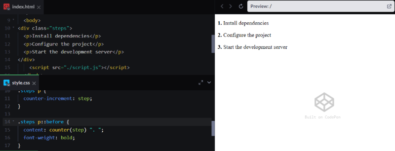

import ReversedCounterDemo from '../../../shared/ui/mdx/reversed-counter-demo.astro';

CSS counters have been around for years, but there's a lesser-known feature that makes counting backwards much easier: `reversed()`.

Normally, CSS counters increase as elements appear on the page. With `reversed()`, you can reverse that behavior and automatically number items from the end of a list to the beginning.

The interesting part is that you don't always need to specify where the countdown starts. The browser can calculate the initial value based on the number of elements.

Let's see how it works, where it's useful, and what to watch out for.

## 1. A Quick Refresher on CSS Counters

Before getting into `reversed()`, let's look at ordinary CSS counters.

A CSS counter typically uses three properties:

- `counter-reset` creates or resets a counter.
- `counter-increment` changes its value.
- `counter()` displays the current value.

Here's a simple example:

```html
<div class="steps">
  <p>Install dependencies</p>
  <p>Configure the project</p>
  <p>Start the development server</p>
</div>
```

```css
.steps {
  counter-reset: step;
}

.steps p {
  counter-increment: step;
}

.steps p::before {
  content: counter(step) ". ";
  font-weight: bold;
}
```

The browser displays:

```text
1. Install dependencies
2. Configure the project
3. Start the development server
```



Each paragraph increments the counter before displaying its value.

Now suppose we want the same list to count backwards.

## 2. Introducing `reversed()`

The `reversed()` function can be used inside `counter-reset` to create a reversed counter.

Its syntax is straightforward:

```css
counter-reset: reversed(step);
```

You can also specify an explicit starting value:

```css
counter-reset: reversed(step) 10;
```

The important difference is that reversed counters have a default decrement of `-1`, rather than the usual increment of `1`.

That means we can use:

```css
counter-increment: step;
```

And the counter will decrease automatically.

There's no need to write `counter-increment: step -1` just to make a reversed counter count down.

## 3. Example: Countdown from 10 to 1

Let's start with a fixed countdown.

```html
<div class="countdown">
  <div>First item</div>
  <div>Second item</div>
  <div>Third item</div>
  <div>Fourth item</div>
  <div>Fifth item</div>
  <div>Sixth item</div>
  <div>Seventh item</div>
  <div>Eighth item</div>
  <div>Ninth item</div>
  <div>Tenth item</div>
</div>
```

<ReversedCounterDemo mode="basic" />


```css
.countdown {
  counter-reset: reversed(count) 10;
}

.countdown > div {
  counter-increment: count;
}

.countdown > div::before {
  content: counter(count) ". ";
  font-weight: 700;
  color: #2563eb;
}
```

The result:

```text
10. First item
 9. Second item
 8. Third item
 7. Fourth item
 6. Fifth item
 5. Sixth item
 4. Seventh item
 3. Eighth item
 2. Ninth item
 1. Tenth item
```

The starting value is explicitly set to `10`, and each element decreases the counter by one.

This approach works well when you already know the number of items.

But there's a more interesting option.

## 4. Automatic Countdown Without a Starting Value

What if the number of items changes?

Maybe you're rendering a list of tasks, notifications, or leaderboard entries from an API.

Hardcoding the initial value would be inconvenient.

Fortunately, reversed counters can calculate their initial value automatically.

```html
<div class="reverse-list">
  <div>HTML</div>
  <div>CSS</div>
  <div>JavaScript</div>
  <div>TypeScript</div>
</div>
```

<ReversedCounterDemo mode="dynamic" />

```css
.reverse-list {
  counter-reset: reversed(item);
}

.reverse-list > div {
  counter-increment: item;
}

.reverse-list > div::before {
  content: counter(item) ". ";
}
```

Output:

```text
4. HTML
3. CSS
2. JavaScript
1. TypeScript
```

Notice that we never specified `4`.

The browser determines the starting value based on the number of elements that increment or decrement the counter within its scope.

Add another item, and the numbering adjusts automatically.

Remove an item, and it updates again.

**This is the biggest advantage of `reversed()` over manually initialized counters.**

One important detail: the initial value is based on the relevant counter operations, not simply every child element. Elements that don't change the counter aren't automatically counted.

<ReversedCounterDemo mode="operations" />

## 5. Reverse Numbering with Semantic HTML Lists

For ordinary ordered lists, HTML already provides a built-in `reversed` attribute.

```html
<ol reversed>
  <li>Third place</li>
  <li>Second place</li>
  <li>First place</li>
</ol>
```

The browser renders:

```text
3. Third place
2. Second place
1. First place
```

<ReversedCounterDemo mode="semantic" />

So why would we need the CSS version?

Because CSS counters are not limited to `<ol>` elements.

You can use them with cards, headings, sections, navigation items, and other elements.

For example:

```html
<section class="ranking">
  <article>Bronze</article>
  <article>Silver</article>
  <article>Gold</article>
</section>
```

```css
.ranking {
  counter-reset: reversed(rank);
}

.ranking article {
  counter-increment: rank;
}

.ranking article::before {
  content: "#" counter(rank);
}
```

Output:

```text
#3 Bronze
#2 Silver
#1 Gold
```

Use native HTML list numbering when it fits the content. Use CSS counters when you need more control over presentation or want to number other types of elements.

## 6. Example: A Countdown with a Custom Step

CSS counters aren't restricted to increments of one.

You can change the counter by any integer value.

For example, let's count down by two.

```html
<div class="countdown-two">
  <span>Step A</span>
  <span>Step B</span>
  <span>Step C</span>
  <span>Step D</span>
  <span>Step E</span>
</div>
```

<ReversedCounterDemo mode="step" />

```css
.countdown-two {
  counter-reset: reversed(number) 10;
}

.countdown-two span {
  display: block;
  counter-increment: number -2;
}

.countdown-two span::before {
  content: counter(number) " — ";
}
```

Output:

```text
8 — Step A
6 — Step B
4 — Step C
2 — Step D
0 — Step E
```

Notice something important.

When you explicitly provide a value to `counter-increment`, that value overrides the default decrement.

Also, the counter is changed before its value is displayed.

That's why the first item shows `8`, not `10`.

If you want to display `10, 8, 6, 4, 2`, initialize the counter at `12` instead.

```css
.countdown-two {
  counter-reset: reversed(number) 12;
}
```

This behavior is easy to overlook when experimenting with custom increments.

## 7. Example: Numbering Cards from Last to First

Here's a more practical UI example.

Imagine a collection of release notes where you want the newest entry to receive the highest number.

```html
<div class="releases">
  <article class="release">
    <h3>Initial release</h3>
    <p>The first public version.</p>
  </article>

  <article class="release">
    <h3>Performance update</h3>
    <p>Faster rendering and smaller bundles.</p>
  </article>

  <article class="release">
    <h3>New dashboard</h3>
    <p>A redesigned analytics experience.</p>
  </article>
</div>
```

```css
.releases {
  counter-reset: reversed(release);
  display: grid;
  gap: 1rem;
}

.release {
  counter-increment: release;
  padding: 1.25rem;
  border: 1px solid #ddd;
  border-radius: 12px;
}

.release h3::before {
  content: "Release " counter(release) " — ";
  color: #2563eb;
}
```

The generated headings will be:

```text
Release 3 — Initial release
Release 2 — Performance update
Release 1 — New dashboard
```

This is particularly useful when the visual numbering should run in the opposite direction from the DOM order.

Just remember that CSS-generated numbering is presentational. It shouldn't replace meaningful content when the numbers need to be accessible, copied, or processed by other systems.

## 8. Combining `reversed()` with `@counter-style`

CSS counters can display more than decimal numbers.

The `@counter-style` rule allows you to define custom numbering systems.

For example, we can display a countdown using Roman numerals.

<ReversedCounterDemo mode="style" />

```css
@counter-style roman-countdown {
  system: extends upper-roman;
  suffix: ". ";
}

.roman-list {
  counter-reset: reversed(section);
}

.roman-list > div {
  counter-increment: section;
}

.roman-list > div::before {
  content: counter(section, roman-countdown);
}
```

With four elements, the output becomes:

```text
IV. Introduction
III. Architecture
II. Implementation
I. Conclusion
```

You can also create your own symbolic numbering style.

```css
@counter-style circled-numbers {
  system: fixed;
  symbols: "①" "②" "③" "④" "⑤";
  suffix: " ";
}
```

Then use it with a reversed counter:

```css
.fancy-list {
  counter-reset: reversed(item);
}

.fancy-list > div {
  counter-increment: item;
}

.fancy-list > div::before {
  content: counter(item, circled-numbers);
}
```

For a five-item list, the result is:

```text
⑤ Fifth
④ Fourth
③ Third
② Second
① First
```

Custom counter styles are useful for tutorials, editorial layouts, documentation, and other interfaces where default decimal numbering feels too plain.

Be aware that a `fixed` counter style only defines symbols for its specified range. Values outside that range use the fallback style.

## 9. Browser Support and Fallbacks

The `reversed()` function is newer than traditional CSS counters, and support needs to be considered separately from the HTML `<ol reversed>` attribute.

<ReversedCounterDemo mode="fallback" />

If your project needs to support browsers without CSS reversed counters, a traditional counter with an explicit negative increment is a straightforward alternative.

```css
/* Fallback */
.legacy-list {
  counter-reset: item 5;
}

.legacy-list > div {
  counter-increment: item -1;
}

.legacy-list > div::before {
  content: counter(item) ". ";
}
```

This produces:

```text
4. First
3. Second
2. Third
1. Fourth
0. Fifth
```

Unlike automatic reversed counters, this fallback requires you to know the initial value.

If the number of items is dynamic, you can calculate that value in JavaScript and expose it through a CSS custom property.

```html
<div class="legacy-list" id="items">
  <div>HTML</div>
  <div>CSS</div>
  <div>JavaScript</div>
</div>
```

```css
.legacy-list {
  counter-reset: item var(--count);
}

.legacy-list > div {
  counter-increment: item -1;
}

.legacy-list > div::before {
  content: counter(item) ". ";
}
```

```js
const list = document.querySelector("#items");

const count = list.children.length;

list.style.setProperty("--count", count + 1);
```

The result is:

```text
3. HTML
2. CSS
1. JavaScript
```

The extra `1` compensates for the fact that the counter is decremented before being displayed.

This fallback works with older CSS counter implementations and doesn't depend on `reversed()`.

If the list changes dynamically after initialization, you'll also need to update the custom property.

## 10. Common Mistakes

There are a few details worth remembering when working with reversed counters.

**Mistake 1: Explicitly decrementing by one unnecessarily**

```css
/* Not needed for a normal reversed countdown */
counter-increment: item -1;
```

For a reversed counter, this produces the same decrement as the default behavior, but it's redundant.

Prefer:

```css
counter-increment: item;
```

**Mistake 2: Assuming the initial value always equals the number of children**

Automatic initialization considers relevant counter operations, not simply the number of direct child elements.

If some elements don't increment the counter, the result may differ from what you expect.

**Mistake 3: Confusing CSS counters with timers**

Despite the name, CSS countdown counters don't count down over time.

They represent values associated with elements in the document.

For a real countdown timer that changes every second, JavaScript is still the appropriate solution.

**Mistake 4: Using generated content for essential information**

CSS counters are great for visual numbering, but they shouldn't be your only source of important information.

If a number has semantic meaning, consider including it in the HTML or exposing it through accessible markup.

## Final Thoughts

The `reversed()` function is a small CSS feature, but it solves a surprisingly common problem.

Instead of manually calculating starting values or adding JavaScript just to number elements backwards, you can let the browser handle the counting.

The automatic starting value is particularly useful for dynamic lists, where items may be added or removed over time.

And because reversed counters work with the existing CSS counter system, you can combine them with custom counter styles, pseudo-elements, and ordinary layout techniques.

It's another example of CSS quietly becoming capable of handling tasks that previously required extra application logic.

**Further reading:**

- [MDN: CSS counter-reset](https://developer.mozilla.org/en-US/docs/Web/CSS/counter-reset)
- [CSS Lists and Counters Level 3](https://drafts.csswg.org/css-lists-3/#reversed-counters)
- [Can I Use: reversed()](https://caniuse.com/mdn-css_properties_counter-reset_reversed)
