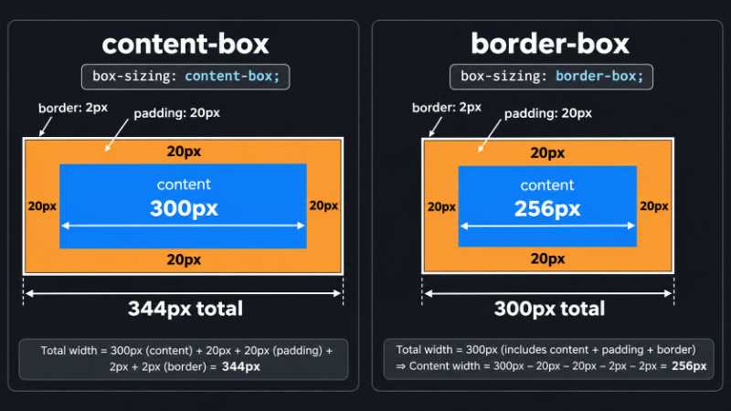
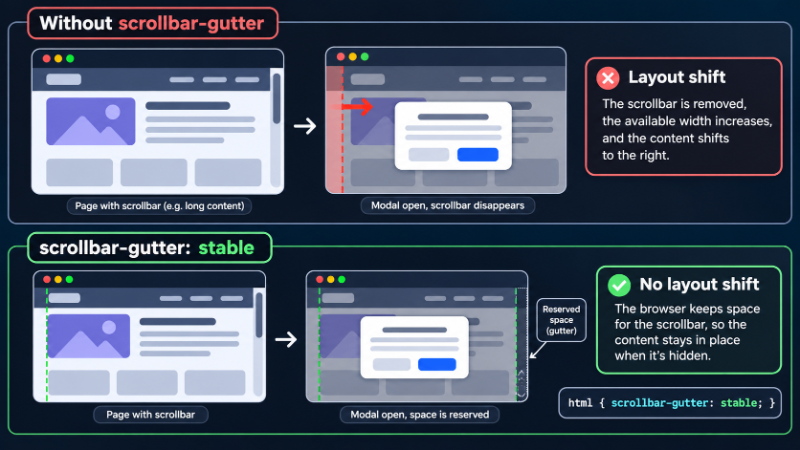
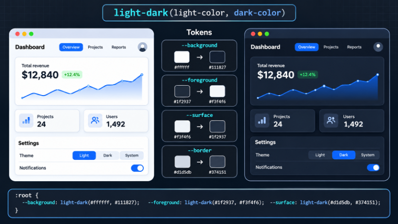
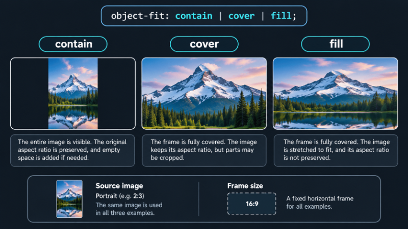

import CssStarterDemo from '../../../shared/ui/mdx/css-starter-demo.astro';

Every new frontend project starts with roughly the same routine. You set up the repository, install a few dependencies, create a layout, and eventually find yourself writing CSS that looks suspiciously familiar.

Fix the box model. Make images responsive. Deal with focus states. Prevent the page from jumping when a modal opens.

None of this is particularly exciting.

What is interesting, however, is how much easier these problems have become to solve with modern CSS. Some of the workarounds that developers have been copying between projects for years can now be replaced with a single property.

A starter stylesheet doesn't need to be a full reset, a framework, or a collection of every clever CSS trick found on the internet. It just needs to provide a reasonable foundation.

Here are 12 defaults worth considering for your next project.

## 1. Start With a Predictable Box Model

Let's get the obvious one out of the way.

If you've ever assigned a width of `300px` to an element and then wondered why it takes up more space after adding padding, you already know the problem.

By default, CSS uses the `content-box` sizing model. Padding and borders are added to the declared width and height.

```css
.card {
  width: 300px;
  padding: 20px;
  border: 2px solid;
}
```

The actual width of this card is 344 pixels: 300 for the content, 40 for the padding and 4 for the borders.

That's rarely what you want when building interfaces.

A small global rule makes things considerably more predictable:

```css
*,
*::before,
*::after {
  box-sizing: border-box;
}
```



Now the declared width includes padding and borders. The card remains 300 pixels wide.

<CssStarterDemo mode="box-sizing" />

This also covers pseudo-elements, which are easy to forget when creating decorative backgrounds, icons, and badges.

It's an old technique, but there is still a good reason to keep it around.

- [MDN: box-sizing](https://developer.mozilla.org/en-US/docs/Web/CSS/box-sizing)

## 2. Stop Layout Shifts When Opening Modals

Modals have an annoying habit of making the entire page move.

You open a dialog, disable background scrolling, and suddenly the navigation bar, content, and everything else shifts a few pixels to the right.

The culprit is usually the disappearing scrollbar.

For a long time, developers solved this by calculating the scrollbar width in JavaScript and applying compensating padding to the document:

```js
const scrollbarWidth =
  window.innerWidth - document.documentElement.clientWidth;

document.body.style.paddingRight = `${scrollbarWidth}px`;
```

Modern CSS offers a much simpler solution:

```css
html {
  scrollbar-gutter: stable;
}
```



The browser reserves space for a classic scrollbar even when it isn't visible. As a result, removing the scrollbar doesn't change the available layout width. For the main page scrollbar, declaring it on the root element is enough.

<CssStarterDemo mode="scrollbar-gutter" />

There is also a useful variation:

```css
html {
  scrollbar-gutter: stable both-edges;
}
```

This reserves matching space on the opposite side of the scrolling container. It can be helpful when maintaining visually centered layouts.

One important detail: operating systems with overlay scrollbars behave differently. Overlay scrollbars don't consume layout space, so there is generally nothing to reserve.

Also, `scrollbar-gutter` doesn't lock scrolling. You still need to handle that separately when opening a modal.

- [MDN: scrollbar-gutter](https://developer.mozilla.org/en-US/docs/Web/CSS/scrollbar-gutter)

## 3. Respect Users Who Prefer Less Motion

Smooth scrolling is one of those little details that can make a website feel more polished.

It takes a single CSS declaration:

```css
html {
  scroll-behavior: smooth;
}
```

Unfortunately, not everyone enjoys animated scrolling. For some people, unexpected movement can cause discomfort, nausea, or dizziness.

There is no need to abandon smooth scrolling altogether. Just make it conditional:

```css
@media (prefers-reduced-motion: no-preference) {
  html {
    scroll-behavior: smooth;
  }
}
```

This enables smooth scrolling only when the user hasn't expressed a preference for reduced motion.

The same approach works nicely for decorative transitions:

```css
@media (prefers-reduced-motion: no-preference) {
  .card {
    transition: transform 200ms ease;
  }

  .card:hover {
    transform: translateY(-4px);
  }
}
```

Some browsers already adjust certain animations based on operating system preferences. Others may behave differently depending on the platform and the type of animation.

It's better to express your intention explicitly.

I would also avoid blindly disabling every animation in a global stylesheet. Some animations communicate meaningful state changes, such as progress, loading, or interaction feedback.

Reduce unnecessary movement first.

- [MDN: prefers-reduced-motion](https://developer.mozilla.org/en-US/docs/Web/CSS/@media/prefers-reduced-motion)

## 4. Make Dark Mode Simpler With light-dark()

Dark mode used to involve a surprising amount of CSS for something as straightforward as changing a few colors.

A typical implementation looks like this:

```css
:root {
  --background: #ffffff;
  --foreground: #1f2937;
}

@media (prefers-color-scheme: dark) {
  :root {
    --background: #111827;
    --foreground: #f3f4f6;
  }
}
```

There is nothing wrong with this approach. It works, and in some situations it remains the better choice.

But if you're mostly switching between two sets of colors, modern CSS has a convenient alternative:

```css
:root {
  color-scheme: light dark;

  --background: light-dark(#ffffff, #111827);
  --foreground: light-dark(#1f2937, #f3f4f6);
  --surface: light-dark(#f3f4f6, #1f2937);
  --border: light-dark(#d1d5db, #374151);
}
```



The first argument passed to `light-dark()` is the color for the light scheme. The second is its dark counterpart. So the background is white in the light theme and dark gray-blue in the dark one, while the text does the opposite.

Note that `light-dark()` only works when `color-scheme` allows both schemes. Without that declaration, the browser always picks the first value.

Now you can use these variables throughout the application without repeatedly checking the user's preferred color scheme:

```css
body {
  background-color: var(--background);
  color: var(--foreground);
}

.card {
  background-color: var(--surface);
  border: 1px solid var(--border);
}
```

<CssStarterDemo mode="color-scheme" />

The `color-scheme` declaration also informs the browser which color schemes the page supports. Native form controls, scrollbars and other browser-rendered interface elements can adapt accordingly.

### Adding a manual theme switcher

What happens if a user prefers a dark operating system but wants your website to stay light?

You can override the color scheme using an attribute:

```css
:root[data-theme="light"] {
  color-scheme: light;
}

:root[data-theme="dark"] {
  color-scheme: dark;
}
```

Then change the attribute from JavaScript:

```js
function setTheme(theme) {
  const root = document.documentElement;

  if (theme === "system") {
    root.removeAttribute("data-theme");
  } else {
    root.dataset.theme = theme;
  }
}
```

You don't need to redefine your entire palette. Every `light-dark()` value follows the new `color-scheme` automatically.

For production applications, you'll probably want to persist the selected theme and apply it before the first render to avoid a flash of the wrong color scheme.

One more thing: `light-dark()` chooses colors. It doesn't guarantee sufficient contrast between them. That's still something you need to check yourself.

- [MDN: light-dark()](https://developer.mozilla.org/en-US/docs/Web/CSS/color_value/light-dark)
- [MDN: color-scheme](https://developer.mozilla.org/en-US/docs/Web/CSS/color-scheme)

## 5. Keep Keyboard Focus Visible

Here's a quick experiment.

Open a website you recently worked on. Put your mouse aside and try navigating the entire interface using the <kbd>Tab</kbd> key.

Can you always tell which element is focused?

If not, there is a problem.

Browser focus indicators exist for a reason. Removing them globally is almost always a bad idea:

```css
/* Don't do this */
*:focus {
  outline: none;
}
```

If the native indicator works well with your design, you can simply leave it alone. There is no requirement to customize it.

When a custom indicator is needed, `:focus-visible` is a good starting point:

```css
:focus-visible {
  outline: 2px solid currentColor;
  outline-offset: 3px;
}
```

Unlike `:focus`, the `:focus-visible` pseudo-class lets the browser decide when a visible focus indicator is appropriate.

That distinction matters. For example, a text input usually matches `:focus-visible` even when focused with a mouse, because the user needs to see where they are typing. It isn't exclusively a keyboard selector.

<CssStarterDemo mode="focus-visible" />

If you use design tokens, keep the width and the color of the ring in separate variables, and make sure the color variable is the one that ends up in `outline-color`:

```css
:root {
  --focus-ring-width: 2px;
  --focus-ring-color: #2563eb;
}

:focus-visible {
  outline: var(--focus-ring-width) solid var(--focus-ring-color);
  outline-offset: 3px;
}
```

### Don't forget forced colors

There is a catch when customizing focus styles.

Users may enable system-level accessibility features that replace your carefully selected interface colors with a restricted palette. Windows High Contrast (now called Contrast Themes) is one example.

If you're providing a custom focus indicator, consider how it behaves in forced colors mode:

```css
@media (forced-colors: active) {
  :focus-visible {
    outline-color: Highlight;
  }
}
```

Here, `Highlight` is a system color keyword rather than a hardcoded design token.

Avoid relying exclusively on `box-shadow` for focus indicators. Shadows are removed in forced colors mode, so a shadow-only ring simply disappears. If you need the shadow for visual reasons, keep a transparent outline next to it: forced colors mode will paint that outline with a visible system color.

```css
.button:focus-visible {
  outline: 2px solid transparent;
  box-shadow: 0 0 0 3px #93c5fd;
}
```

And remember that `currentColor` doesn't automatically guarantee sufficient contrast against every surrounding surface.

A custom focus ring should be an improvement over the browser default, not merely something that looks different.

- [MDN: :focus-visible](https://developer.mozilla.org/en-US/docs/Web/CSS/:focus-visible)
- [MDN: forced-colors](https://developer.mozilla.org/en-US/docs/Web/CSS/@media/forced-colors)
- [WCAG: Focus Visible](https://www.w3.org/WAI/WCAG22/Understanding/focus-visible.html)

## 6. Let the Browser Balance Your Headings

Multiline headings occasionally look awkward.

A relatively long title fills the available width, wraps onto another line, and leaves a single word sitting by itself.

You could insert a manual line break, but then the layout changes on another screen size and you're back where you started.

CSS can handle this now:

```css
h1,
h2,
h3,
h4,
h5,
h6 {
  text-wrap: balance;
}
```

With balanced wrapping, the browser tries to distribute text more evenly across the available lines. Drag the width slider and compare the three values:

<CssStarterDemo mode="text-wrap" />

This is particularly useful for hero sections, article titles, card headings, and promotional blocks.

It isn't intended for large amounts of text, though. Browsers limit how many lines they balance, and those limits can vary between implementations.

### Making the rule configurable

If you're building a reusable stylesheet, you can expose the wrapping behavior through a custom property:

```css
:where(h1, h2, h3, h4, h5, h6) {
  text-wrap: var(--heading-wrap, balance);
}
```

The second argument of `var()` is a fallback. If `--heading-wrap` isn't defined anywhere up the tree, the browser uses `balance`. Keep in mind that the fallback only kicks in when the variable is missing; if it is defined with an invalid value, the declaration becomes invalid at computed-value time and the property falls back to its initial value instead.

You can override it globally:

```css
:root {
  --heading-wrap: wrap;
}
```

Or only within a specific component:

```css
.article-card {
  --heading-wrap: balance;
}

.data-table {
  --heading-wrap: wrap;
}
```

Because custom properties inherit by default, headings inside these components receive the corresponding value.

The `:where()` pseudo-class also keeps selector specificity at zero, making the default easier to override.

For a small website, the plain `text-wrap: balance` declaration may be all you need. There is no reason to turn every CSS property into a design token.

- [MDN: text-wrap](https://developer.mozilla.org/en-US/docs/Web/CSS/text-wrap)
- [MDN: var()](https://developer.mozilla.org/en-US/docs/Web/CSS/var)

## 7. Give Paragraphs a Little More Attention

While `balance` works well for headings, paragraphs have different requirements.

Consider this:

```css
p {
  text-wrap: pretty;
}
```

The `pretty` value lets the browser use a wrapping strategy that prioritizes better typography, potentially at the expense of some performance.

Depending on the browser, it may help avoid awkward short final lines and improve other wrapping decisions. Browsers that don't support it simply keep the normal wrapping, so it is safe to add.

It's especially useful on content-heavy websites, such as blogs, documentation, and online magazines.

Another small improvement is limiting the width of long-form content:

```css
.prose {
  max-inline-size: 70ch;
  margin-inline: auto;
  line-height: 1.7;
}
```

The `ch` unit is based on the width of the zero character in the current font. It gives you a convenient approximation for controlling line length.

A value of `70ch` doesn't mean every line contains exactly 70 characters, but it's a reasonable starting point.

I wouldn't apply these rules to every paragraph in a dashboard. Article text and compact interface labels have different jobs.

## 8. Make Images Responsive by Default

Images have a rather inconvenient ability to break otherwise perfectly responsive layouts.

An uploaded image might be much wider than the available container. Another might have the wrong proportions for a card component.

A sensible baseline looks like this:

```css
:where(img, video) {
  max-inline-size: 100%;
  block-size: auto;
}
```

Images can now shrink when their container is narrower than their intrinsic width, without being stretched or squashed.

If you're working with standalone media rather than inline illustrations, you might also want:

```css
.media > :is(img, video) {
  display: block;
}
```

This removes the extra space under the image caused by inline baseline alignment.

I prefer applying this behavior to media components rather than globally. Some images, particularly inline icons and illustrations, are intentionally part of the text flow.

### Preventing layout shifts

Responsive sizing alone doesn't solve layout shifts. Neither does `aspect-ratio: auto` on its own.

When the browser doesn't know an image's dimensions before downloading it, the surrounding content may move once the image loads.

The simplest solution is to provide dimensions in HTML:

```html

```

Modern browsers use these attributes to calculate the aspect ratio and reserve space before the image finishes loading. The responsive CSS above still allows the image to shrink, and `block-size: auto` keeps the proportions correct.

For images immediately visible above the fold, especially the main article image, use eager loading instead of `loading="lazy"`. Lazy-loading the largest image on the screen delays your Largest Contentful Paint.

### Handling inconsistent image proportions

Suppose you're building a grid of articles and the uploaded covers have completely different proportions.

You want every cover to occupy the same amount of space:

```css
.article-cover {
  inline-size: 100%;
  aspect-ratio: 16 / 9;
  object-fit: cover;
  object-position: center;
}
```



Now the image has a predictable frame.

`object-fit: cover` fills that frame while preserving the source image's proportions. Anything outside the frame is cropped.

Sometimes the important part of the image sits near the top:

```css
.article-cover--portrait {
  object-position: center top;
}
```

This changes which part of the image remains visible. Try it with a portrait image inside a landscape frame:

<CssStarterDemo mode="object-fit" />

Notice that these rules belong to a specific image component.

Applying `object-fit: cover` to every image on a website could accidentally crop logos, diagrams, screenshots, and other content that needs to remain fully visible.

- [MDN: aspect-ratio](https://developer.mozilla.org/en-US/docs/Web/CSS/aspect-ratio)
- [MDN: object-fit](https://developer.mozilla.org/en-US/docs/Web/CSS/object-fit)
- [web.dev: Optimize Cumulative Layout Shift](https://web.dev/articles/optimize-cls)

## 9. Make Form Controls Inherit Your Typography

Have you ever styled an entire page, added a button, and noticed that its font looks slightly different from everything around it?

Native form controls don't inherit typography from their parent elements by default. Browsers give them their own system font and size.

A small rule fixes most of that inconsistency:

```css
:where(button, input, textarea, select) {
  font: inherit;
}
```

This makes form controls use the inherited font family, size, weight, and line height.

You may also want them to inherit the surrounding text color:

```css
:where(button, input, textarea, select) {
  font: inherit;
  color: inherit;
}
```

This doesn't remove native borders, backgrounds, or other platform-specific styling.

That's intentional.

Completely stripping native form control styles with `appearance: none` creates additional work. You become responsible for rebuilding visual states, accessibility indicators, and interaction feedback.

Sometimes a native control with consistent typography is perfectly adequate.

## 10. Fix Unexpected Flexbox and Grid Overflow

Here's a problem that keeps appearing in frontend projects, even among experienced developers.

You create a simple flex layout:

```css
.layout {
  display: flex;
  gap: 1rem;
}

.sidebar {
  flex: 0 0 240px;
}

.content {
  flex: 1;
}
```

Everything looks fine until the main content contains a long URL, a code block, or a particularly wide table.

Suddenly the entire layout overflows.

The reason is the automatic minimum size of flex items. By default, a flex item's `min-width` is `auto`, which means it refuses to shrink below the width of its content.

The fix:

```css
.content {
  flex: 1;
  min-inline-size: 0;
}
```

This allows the content area to shrink below that automatic minimum. Toggle the fix and watch where the scrollbar appears:

<CssStarterDemo mode="flex-overflow" />

You'll still need to decide how the actual content should behave.

For code blocks, horizontal scrolling is often appropriate:

```css
pre {
  max-inline-size: 100%;
  overflow-x: auto;
}
```

For long URLs or user-generated text, wrapping may be better:

```css
.prose {
  overflow-wrap: anywhere;
}
```

Grid has a related problem. A `1fr` track has an automatic minimum as well, so it grows with wide content. Instead of writing:

```css
.grid {
  display: grid;
  grid-template-columns: 1fr 1fr;
}
```

You can explicitly allow both columns to shrink:

```css
.grid {
  display: grid;
  grid-template-columns: repeat(2, minmax(0, 1fr));
}
```

These aren't rules that need to be applied to every element globally. They are useful defaults for flexible content regions where overflow is a realistic possibility.

- [MDN: min-width](https://developer.mozilla.org/en-US/docs/Web/CSS/min-width)

## 11. Prefer Logical Properties

CSS has traditionally described layouts in physical directions.

Left. Right. Top. Bottom.

That works until your interface needs to support languages with different writing directions.

Consider a sidebar with the following spacing:

```css
.sidebar {
  padding-left: 1rem;
  margin-right: 2rem;
}
```

Those directions are fixed, regardless of how the document is written.

Logical properties describe spacing relative to the document's writing mode instead:

```css
.sidebar {
  padding-inline-start: 1rem;
  margin-inline-end: 2rem;
}
```

For an English interface, the result looks exactly the same.

For a right-to-left interface, the spacing follows the writing direction automatically. Switch the direction below: the physical version keeps its accent on the left, while the logical one moves it to where the text starts.

<CssStarterDemo mode="logical-properties" />

Here are a few replacements that are worth getting comfortable with:

| Physical property  | Logical alternative   |
| ------------------ | --------------------- |
| `width`            | `inline-size`         |
| `height`           | `block-size`          |
| `max-width`        | `max-inline-size`     |
| `margin-left`      | `margin-inline-start` |
| `padding-right`    | `padding-inline-end`  |
| `margin-top`       | `margin-block-start`  |
| `text-align: left` | `text-align: start`   |

These equivalents assume a conventional horizontal left-to-right writing mode.

There is no need to convert every physical property mechanically. A decorative element that must always appear on the physical left side of an image should probably keep using `left`.

But for ordinary layout and spacing, logical properties are a good habit.

- [MDN: CSS logical properties and values](https://developer.mozilla.org/en-US/docs/Web/CSS/CSS_logical_properties_and_values)

## 12. Use Cascade Layers for Your Base Styles

A starter stylesheet is easy to manage when it contains 50 lines of CSS.

Things become more complicated when the project grows, third-party styles appear, and dozens of components start overriding one another.

CSS cascade layers provide a way to organize styles according to their purpose:

```css
@layer reset, base, components, utilities;
```

For normal declarations, later layers have higher priority than earlier ones.

Now you can put foundational styles in their own layer:

```css
@layer base {
  :where(h1, h2, h3, h4, h5, h6) {
    text-wrap: balance;
  }

  :where(button, input, textarea, select) {
    font: inherit;
  }
}
```

Component styles belong elsewhere:

```css
@layer components {
  .dashboard-title {
    text-wrap: wrap;
  }
}
```

The component layer takes precedence over the base layer without requiring increasingly complicated selectors.

This makes the starter stylesheet less intrusive. Its job is to provide defaults, not fight your application.

There are two important details to remember. Normal unlayered author styles take precedence over normal layered author styles, and `!important` reverses the layer priority order.

If your framework already defines its own layer structure, work with that structure rather than introducing a competing one.

- [MDN: @layer](https://developer.mozilla.org/en-US/docs/Web/CSS/@layer)

## Putting Everything Together

Let's turn these individual ideas into a stylesheet.

The following example is intentionally small. It doesn't attempt to normalize every browser inconsistency or replace native HTML styling.

It's just a starting point that you can adapt.

```css
/* starter.css */
@layer reset, base, components, utilities;

@layer reset {
  *,
  *::before,
  *::after {
    box-sizing: border-box;
  }

  body {
    margin: 0;
  }
}

@layer base {
  :root {
    color-scheme: light dark;
    scrollbar-gutter: stable;

    --background: light-dark(#ffffff, #111827);
    --foreground: light-dark(#1f2937, #f3f4f6);
    --surface: light-dark(#f3f4f6, #1f2937);
    --border: light-dark(#d1d5db, #374151);

    --heading-wrap: balance;
  }

  :root[data-theme="light"] {
    color-scheme: light;
  }

  :root[data-theme="dark"] {
    color-scheme: dark;
  }

  body {
    min-block-size: 100vh;
    min-block-size: 100dvh;
    font-family: system-ui, sans-serif;
    line-height: 1.5;
    background-color: var(--background);
    color: var(--foreground);
  }

  @media (prefers-reduced-motion: no-preference) {
    html {
      scroll-behavior: smooth;
    }
  }

  :where(h1, h2, h3, h4, h5, h6) {
    text-wrap: var(--heading-wrap, balance);
  }

  :where(p) {
    text-wrap: pretty;
  }

  :where(img, video) {
    max-inline-size: 100%;
    block-size: auto;
  }

  :where(button, input, textarea, select) {
    font: inherit;
    color: inherit;
  }

  :where(pre) {
    max-inline-size: 100%;
    overflow-x: auto;
  }

  :where(textarea) {
    resize: vertical;
  }
}

@layer components {
  .prose {
    max-inline-size: 70ch;
    margin-inline: auto;
    line-height: 1.7;
    overflow-wrap: anywhere;
  }

  .article-cover {
    display: block;
    inline-size: 100%;
    aspect-ratio: 16 / 9;
    object-fit: cover;
    object-position: center;
  }
}

@layer utilities {
  .min-inline-0 {
    min-inline-size: 0;
  }
}
```

You might notice that the stylesheet doesn't include custom focus indicators.

That's deliberate. The browser already provides them, and the base stylesheet shouldn't replace useful native behavior without a good reason.

If your design system needs a consistent focus treatment, you can add the custom version discussed earlier and test it against your actual interface, including forced colors mode.

The `min-block-size: 100vh` line is a fallback for browsers that don't understand `dvh`: they ignore the second declaration and keep the first one.

The stylesheet assumes modern browser support. If your project targets older browsers, check the compatibility of the newer features, particularly `light-dark()` and `text-wrap: pretty`, and introduce fallbacks where necessary.

## What I Wouldn't Put in a Global Stylesheet

It's tempting to keep adding rules until your starter stylesheet handles every situation you've encountered.

Eventually, that becomes a problem of its own.

There are several declarations I would avoid applying indiscriminately:

| Global declaration      | Potential problem                           |
| ----------------------- | ------------------------------------------- |
| `outline: none`         | Removes keyboard focus indicators           |
| `overflow-x: hidden`    | Can conceal underlying layout problems      |
| `object-fit: cover`     | Can crop meaningful image content           |
| `transition: all`       | Animates unintended property changes        |
| `user-select: none`     | Prevents ordinary text selection            |
| `appearance: none`      | Removes useful native control styling       |
| `word-break: break-all` | Makes ordinary text harder to read          |
| `* { margin: 0; }`      | Removes meaningful default document spacing |

None of these properties are inherently bad. They just solve specific problems.

The more opinionated a global stylesheet becomes, the more time you'll spend undoing its decisions in individual components.

## Final Thoughts

Modern CSS has reached a point where many familiar frontend problems no longer require elaborate workarounds.

The browser can reserve scrollbar space, balance headings, choose theme colors, preserve image proportions, and respect user accessibility preferences. All of that can happen before a single JavaScript component is initialized.

A good starter stylesheet should make these capabilities available without making the rest of the application harder to style.

Keep it small. Make it easy to override. Add new rules when they solve problems you actually encounter.