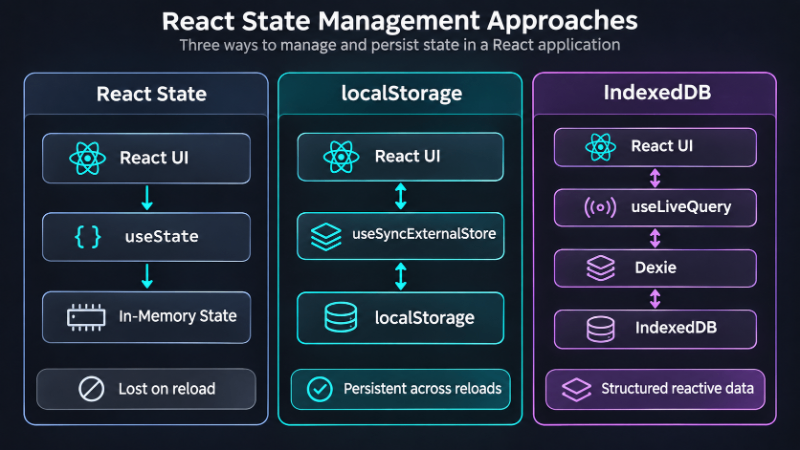
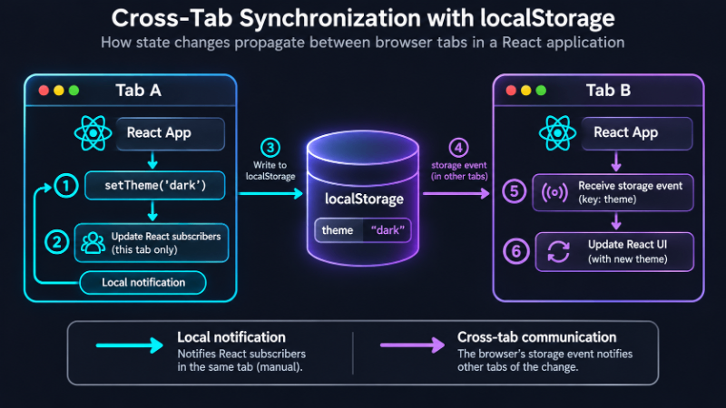
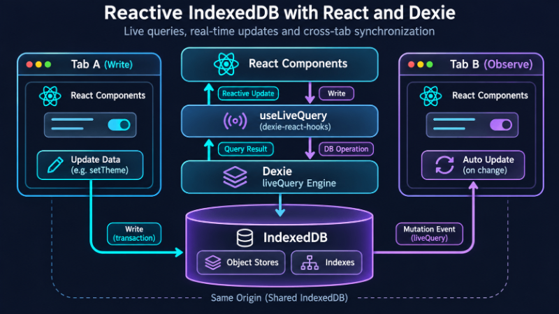

React makes it easy to manage state inside a component. Sharing that state across an application is another matter. Keeping it after a page reload introduces a new problem, and synchronizing it between browser tabs adds yet another layer of complexity.

Libraries such as Redux, Zustand, and Jotai solve different parts of the state management problem. They provide mechanisms for storing, updating, and subscribing to application state. Persistence, however, is usually an additional feature rather than an inherent property of the state itself.

Browsers already provide storage APIs that can help.

`localStorage` offers a simple synchronous key-value interface. IndexedDB provides an asynchronous database with transactions, indexes, and support for larger structured datasets.

Both can be integrated with React, but neither automatically becomes a reactive state manager.

In this tutorial, we'll explore three approaches:

1. React state held in memory.
2. Persistent state backed by `localStorage`.
3. Reactive IndexedDB queries powered by Dexie.

We'll build the same theme switcher with each approach, examine how multiple tabs behave, and test the implementations. More importantly, we'll identify where browser storage is useful and where a conventional state management solution is still the better choice.

## **1. State management and persistence are different problems**

Consider a simple React application with a theme setting.

A user selects dark mode. React updates the interface, and everything works until the page is refreshed.

Why?

Because ordinary React state lives in JavaScript memory. When the document is unloaded, that state disappears.

Conceptual overview. Storage keeps data; React still needs a way to observe changes.

A state management library can persist selected values to browser storage. Alternatively, we can build a small reactive adapter around the storage API.

The important distinction is that storage and reactivity solve separate problems.

A persistent value is not necessarily reactive. And reactive state is not necessarily persistent.



### **Choosing the right browser API**

| Feature                 | localStorage                         | IndexedDB                                   |
| ----------------------- | ------------------------------------ | ------------------------------------------- |
| API                     | Synchronous                          | Asynchronous                                |
| Data format             | Strings                              | Structured-clone values                     |
| Typical capacity        | Small, often around 5 MiB per origin | Larger, quota-dependent                     |
| Queries and indexes     | No                                   | Yes                                         |
| Transactions            | No multi-operation transactions      | Yes                                         |
| Cross-tab notifications | `storage` event                      | Library-based subscriptions or coordination |
| Best for                | Preferences, small settings          | Offline data, records, collections          |

IndexedDB is an object-store database, not a relational SQL database. It supports indexed queries, but it does not provide SQL joins or a relational schema.

Storage limits also vary between browsers, devices, and browsing modes. Browser-managed data can be evicted, so persistence should never be confused with a guaranteed backup.

For more details, see [MDN: Storage quotas and eviction criteria](https://developer.mozilla.org/en-US/docs/Web/API/Storage_API/Storage_quotas_and_eviction_criteria).

## **2. Creating the React application**

We'll use React, TypeScript, and Vite.

```bash
npm create vite@latest browser-state-demo -- --template react-ts
cd browser-state-demo
npm install
npm run dev
```

Our example will contain a small settings component and a root component that applies the selected theme.

First, define the theme type.

```ts
// src/types.ts
export type Theme = 'light' | 'dark'
```

Next, create a reusable settings component.

```ts
// src/components/ThemeSelector.tsx
import type { Theme } from '../types'

type Props = {
  theme: Theme
  onChange: (theme: Theme) => void
}

export function ThemeSelector({ theme, onChange }: Props) {
  return (
    <fieldset>
      <legend>Appearance</legend>

      <label>
        <input
          type="radio"
          name="theme"
          value="light"
          checked={theme === 'light'}
          onChange={() => onChange('light')}
        />
        Light
      </label>

      <label>
        <input
          type="radio"
          name="theme"
          value="dark"
          checked={theme === 'dark'}
          onChange={() => onChange('dark')}
        />
        Dark
      </label>
    </fieldset>
  )
}
```

We deliberately keep this component independent of the storage implementation.

It receives the current theme and a callback. It doesn't know whether the value comes from React state, `localStorage`, IndexedDB, or a remote API.

This separation will allow us to reuse the component without rewriting its tests.

Add a small stylesheet.

```css
/* src/style.css */
body {
  margin: 0;
  font-family: system-ui, sans-serif;
}

.app {
  min-height: 100vh;
  padding: 2rem;
  box-sizing: border-box;
  background: #ffffff;
  color: #171717;
}

.app.dark {
  background: #171717;
  color: #f5f5f5;
}

fieldset {
  display: flex;
  gap: 1rem;
  width: fit-content;
  border: 1px solid currentColor;
  border-radius: 8px;
  padding: 1rem;
}

label {
  cursor: pointer;
}
```

The interface is intentionally simple. Our goal is to compare storage strategies, not build a design system.

## **3. Approach One: React state in memory**

Start with the simplest possible implementation.

```ts
// src/App.tsx
import { useState } from 'react'
import { ThemeSelector } from './components/ThemeSelector'
import type { Theme } from './types'

export default function App() {
  const [theme, setTheme] = useState<Theme>('light')

  return (
    <main className={`app ${theme}`}>
      <h1>React Theme Settings</h1>
      <ThemeSelector theme={theme} onChange={setTheme} />
    </main>
  )
}
```

This works without any external dependencies.

React updates the interface whenever `setTheme` changes the state. Components receiving the theme through props render the appropriate appearance.

There are two limitations.

First, refreshing the page resets the theme to `light`. Second, opening the application in another tab creates a separate JavaScript environment with its own state.

Neither behavior is a React bug. The state is doing exactly what it was designed to do.

For applications that need only temporary UI state, this is often enough.

A dropdown's open state, the active tab in a dialog, or a temporary form interaction usually doesn't need to survive a browser restart.

Persisting everything can introduce more problems than it solves.

## **4. Approach Two: Reactive localStorage**

The Web Storage API gives us a straightforward way to persist small values.

```js
localStorage.setItem('theme', 'dark')

const theme = localStorage.getItem('theme')
```

The value remains available after a reload, assuming the browser retains the site's data.

However, `localStorage` does not automatically notify React components when its contents change.

We need to connect it to React's subscription mechanism.

### **Using useSyncExternalStore**

React provides a hook specifically designed for subscribing to external stores: [useSyncExternalStore](https://react.dev/reference/react/useSyncExternalStore).

It accepts a subscription function and a snapshot getter.

Let's implement a small theme store.

```ts
// src/stores/localThemeStore.ts
import { useSyncExternalStore } from 'react'
import type { Theme } from '../types'

const KEY = 'react-demo:theme'
const DEFAULT_THEME: Theme = 'light'

const listeners = new Set<() => void>()

function isTheme(value: string | null): value is Theme {
  return value === 'light' || value === 'dark'
}

function getSnapshot(): Theme {
  try {
    const value = localStorage.getItem(KEY)
    return isTheme(value) ? value : DEFAULT_THEME
  } catch {
    return DEFAULT_THEME
  }
}

function emitChange() {
  listeners.forEach(listener => listener())
}

function subscribe(listener: () => void) {
  listeners.add(listener)

  return () => {
    listeners.delete(listener)
  }
}

export function setTheme(theme: Theme) {
  try {
    localStorage.setItem(KEY, theme)
  } catch {
    // Storage may be unavailable or full.
  }

  emitChange()
}

if (typeof window !== 'undefined') {
  window.addEventListener('storage', event => {
    if (event.key === KEY || event.key === null) {
      emitChange()
    }
  })
}

export function useStoredTheme(): Theme {
  return useSyncExternalStore(
    subscribe,
    getSnapshot,
    () => DEFAULT_THEME
  )
}
```

There are several details worth examining.

The `getSnapshot` function reads the current value and validates it. If storage contains an unexpected string, we fall back to the default theme.

The `subscribe` function registers React's listener.

Calling `setTheme` updates browser storage and notifies subscribers in the current document.

Finally, the `storage` event handles changes made in other tabs sharing the same storage area.

### **Why the storage event is not enough**



The browser does not dispatch a `storage` event to the document that performed the write.

If our implementation relied exclusively on that event, the originating tab might not update immediately.

That's why `setTheme` calls `emitChange()` explicitly.

Important: This example assumes all writes to the theme key go through `setTheme`. Direct writes elsewhere in the same tab will not notify React subscribers. For a larger application, centralize storage writes behind a single adapter.

### **Connecting the store to React**

Replace the previous `App.tsx` implementation.

```ts
// src/App.tsx
import { ThemeSelector } from './components/ThemeSelector'
import {
  setTheme,
  useStoredTheme
} from './stores/localThemeStore'

export default function App() {
  const theme = useStoredTheme()

  return (
    <main className={`app ${theme}`}>
      <h1>Persistent Theme Settings</h1>
      <ThemeSelector theme={theme} onChange={setTheme} />
    </main>
  )
}
```

Now open the application in two tabs.

Change the theme in one tab. The other tab should update as well.

Reload either page, and the saved preference remains available.

We now have a small persistent external store without Redux, Zustand, or another state management dependency.

### **A note about server-side rendering**

Our snapshot getter reads `localStorage`, which exists only in the browser.

The third argument to `useSyncExternalStore` supplies a server snapshot, but that doesn't automatically solve every hydration issue.

If the server renders the light theme while the browser has dark mode saved, the initial HTML can briefly display the wrong appearance.

Production applications should define an explicit strategy for initial theme selection. Options include a server-readable cookie, an early inline theme script, or rendering a neutral initial state.

For this client-rendered Vite example, the implementation is sufficient.

## **5. Approach Three: IndexedDB with Dexie**

`localStorage` is convenient for small settings. It becomes less attractive when an application needs hundreds or thousands of records, indexed queries, or transactional updates.

Imagine a note-taking application that stores documents, tags, drafts, and search metadata.

Saving the entire dataset as one JSON string would require repeatedly serializing and rewriting it.

IndexedDB is designed for more complex browser-side storage.

Its native API is powerful but verbose. [Dexie.js](https://dexie.org) provides a more approachable interface, while `dexie-react-hooks` connects reactive queries to React.

Install both packages:

```bash
npm install dexie dexie-react-hooks
```

### **Define the database**

We'll continue with the theme example so that the UI stays identical.

```ts
// src/db.ts
import Dexie, { type Table } from 'dexie'
import type { Theme } from './types'

export interface Settings {
  id: string
  theme: Theme
}

class AppDatabase extends Dexie {
  settings!: Table<Settings, string>

  constructor() {
    super('ReactSettingsDemo')

    this.version(1).stores({
      settings: 'id'
    })
  }
}

export const db = new AppDatabase()
```

The database contains a `settings` object store with a string primary key.

The schema lists the primary key, not every property stored in a record. IndexedDB does not require us to declare ordinary non-indexed fields.

### **Initialize the default settings**

We need to ensure that the record exists before updating it.

A safe approach is to use `put` for initialization only when the record is absent, and to await the operation.

```ts
// src/settingsRepository.ts
import { db } from './db'
import type { Theme } from './types'

const SETTINGS_ID = 'appearance'

export async function initializeSettings() {
  await db.transaction('rw', db.settings, async () => {
    const existing = await db.settings.get(SETTINGS_ID)

    if (!existing) {
      await db.settings.add({
        id: SETTINGS_ID,
        theme: 'light'
      })
    }
  })
}

export async function updateTheme(theme: Theme) {
  await db.settings.put({
    id: SETTINGS_ID,
    theme
  })
}
```

Using a transaction during initialization avoids a read-then-write race between two callers performing initialization concurrently.

`put` performs an upsert. This means `updateTheme` can write the selected theme even if the record has not yet been created.

For a single setting, this is more robust than assuming that an earlier asynchronous initialization has already finished.

### **Subscribe to database changes**

Dexie's React integration exposes `useLiveQuery`, which automatically observes the IndexedDB operations used by a query.

```tsx
// src/App.tsx
import { useLiveQuery } from 'dexie-react-hooks'
import { ThemeSelector } from './components/ThemeSelector'
import { db } from './db'
import { updateTheme } from './settingsRepository'

export default function App() {
  const settings = useLiveQuery(
    () => db.settings.get('appearance'),
    []
  )

  const theme = settings?.theme ?? 'light'

  return (
    <main className={`app ${theme}`}>
      <h1>IndexedDB Theme Settings</h1>
      <ThemeSelector
        theme={theme}
        onChange={nextTheme => {
          void updateTheme(nextTheme).catch(console.error)
        }}
      />
    </main>
  )
}
```

The query returns the settings record. When Dexie detects a relevant database mutation, it can rerun the query and update the React component.

Unlike the original Vue-based approach, we don't need RxJS, an Observable adapter, or an unsafe `any` cast.

The React integration is provided directly by Dexie.

For a production interface, we should also distinguish the initial loading state from an absent record and display errors when writes fail.

### **Initialize before rendering**

Update the application entry point.

```tsx
// src/main.tsx
import React from 'react'
import ReactDOM from 'react-dom/client'
import App from './App'
import { initializeSettings } from './settingsRepository'
import './style.css'

async function main() {
  await initializeSettings()

  ReactDOM.createRoot(
    document.getElementById('root')!
  ).render(
    <React.StrictMode>
      <App />
    </React.StrictMode>
  )
}

main().catch(error => {
  console.error('Application initialization failed', error)
})
```

This ensures the default record exists before the application is rendered.

A production application should display a useful error or recovery interface if database initialization fails, rather than leaving the page empty.

### **Does IndexedDB synchronize across tabs?**



IndexedDB provides shared persistent storage for same-origin documents, but it does not automatically make React components reactive.

Dexie's `liveQuery` infrastructure tracks relevant mutations and supports cross-context observation in supported environments.

This allows our theme example to update across tabs without manually wiring a `storage` event.

However, cross-tab observation is not the same as conflict resolution. If two tabs write different values almost simultaneously, the application still needs a policy for determining which value should win.

For a theme preference, last successful write may be acceptable.

For collaborative documents or financial records, it usually isn't.

See [Dexie: useLiveQuery documentation](https://dexie.org/docs/dexie-react-hooks/useLiveQuery()).

## **6. Testing the implementations**

Tests should verify observable behavior rather than tightly coupling UI assertions to storage internals.

Our `ThemeSelector` component is independent of the storage provider. That makes it easy to test.

Install the testing dependencies:

```bash
npm install -D vitest jsdom \
  @testing-library/react \
  @testing-library/user-event \
  @testing-library/jest-dom \
  fake-indexeddb
```

Configure Vitest using the Vite React plugin.

```ts
// vitest.config.ts
import { defineConfig } from 'vitest/config'
import react from '@vitejs/plugin-react'

export default defineConfig({
  plugins: [react()],
  test: {
    environment: 'jsdom',
    setupFiles: ['./src/test/setup.ts']
  }
})
```

Create the setup file.

```ts
// src/test/setup.ts
import '@testing-library/jest-dom/vitest'
import 'fake-indexeddb/auto'
```

`fake-indexeddb` provides an in-memory implementation of IndexedDB for the test environment.

It should be imported before modules that initialize or use the database. In a larger test suite, consider creating a fresh database per test or explicitly clearing test data to prevent state leakage.

### **Testing the shared UI**

```ts
// src/components/ThemeSelector.test.tsx
import { expect, it, vi } from 'vitest'
import { render, screen } from '@testing-library/react'
import userEvent from '@testing-library/user-event'
import { ThemeSelector } from './ThemeSelector'

it('notifies the parent when the theme changes', async () => {
  const user = userEvent.setup()
  const onChange = vi.fn()

  render(
    <ThemeSelector theme="light" onChange={onChange} />
  )

  expect(
    screen.getByRole('radio', { name: 'Light' })
  ).toBeChecked()

  await user.click(
    screen.getByRole('radio', { name: 'Dark' })
  )

  expect(onChange).toHaveBeenCalledWith('dark')
})
```

Notice what this test doesn't do.

It doesn't inspect `localStorage`, open IndexedDB, or check the root element's CSS classes.

The component's responsibility is to display a selected value and report user interaction. That's what the test verifies.

### **Testing the localStorage store**

The persistence layer deserves separate tests.

```ts
// src/stores/localThemeStore.test.ts
import { beforeEach, expect, it } from 'vitest'
import {
  setTheme,
  useStoredTheme
} from './localThemeStore'
import { renderHook, act } from '@testing-library/react'

beforeEach(() => {
  localStorage.clear()
})

it('persists the selected theme', () => {
  const { result } = renderHook(() => useStoredTheme())

  act(() => {
    setTheme('dark')
  })

  expect(result.current).toBe('dark')
  expect(
    localStorage.getItem('react-demo:theme')
  ).toBe('dark')
})
```

This verifies both the external store's observable value and its persistence behavior.

For cross-tab synchronization, a real-browser test is preferable. A simulated DOM environment does not reproduce every browser storage behavior.

### **Testing IndexedDB**

Database tests can operate directly on the repository.

```ts
// src/settingsRepository.test.ts
import { beforeEach, expect, it } from 'vitest'
import { db } from './db'
import {
  initializeSettings,
  updateTheme
} from './settingsRepository'

beforeEach(async () => {
  await db.settings.clear()
})

it('creates default settings', async () => {
  await initializeSettings()

  const settings = await db.settings.get('appearance')

  expect(settings?.theme).toBe('light')
})

it('updates the stored theme', async () => {
  await initializeSettings()
  await updateTheme('dark')

  const settings = await db.settings.get('appearance')

  expect(settings?.theme).toBe('dark')
})

it('preserves existing settings during initialization', async () => {
  await updateTheme('dark')
  await initializeSettings()

  const settings = await db.settings.get('appearance')

  expect(settings?.theme).toBe('dark')
})
```

For React integration tests involving asynchronous queries, Testing Library's `waitFor` is generally a better choice than relying on timing assumptions or unrelated empty transactions.

```ts
await waitFor(() => {
  expect(screen.getByRole('radio', {
    name: 'Dark'
  })).toBeChecked()
})
```

This assertion belongs in a test that renders the IndexedDB-backed application and performs a theme change.

It waits for the behavior we care about, rather than for an implementation detail that might or might not correspond to the UI update.

## **7. Important limitations of browser storage**

Browser storage is useful, but several constraints deserve attention before adopting it as an application's primary persistence layer.

### **Storage can disappear**

IndexedDB and `localStorage` are not permanent guarantees.

Users can clear site data. Browsers may evict data under storage pressure, and private browsing sessions often have different retention behavior.

The Storage API exposes `navigator.storage.persist()` for requesting persistent storage in supported browsers.

```ts
if (navigator.storage?.persist) {
  const granted = await navigator.storage.persist()
  console.log('Persistent storage:', granted)
}
```

Permission is not guaranteed, and persistent storage does not protect against deliberate deletion by the user.

If data is irreplaceable, provide a backup, export, or server synchronization mechanism.

### **Synchronous storage can block rendering**

`localStorage` reads and writes are synchronous.

For a small theme preference, this is rarely a concern. Repeatedly serializing large objects during frequent updates can become expensive.

IndexedDB performs its operations asynchronously and is generally a better fit for larger datasets.

### **Browser storage is not a secure vault**

Never store passwords, private API keys, or long-lived sensitive credentials in browser storage simply because the data persists.

JavaScript running in the same origin can access `localStorage` and IndexedDB, including malicious scripts introduced through an XSS vulnerability.

For authentication, consider server-managed sessions and appropriately configured secure cookies.

### **Multiple tabs can overwrite each other**

Cross-tab notifications make changes visible. They do not make every operation atomic or conflict-free.

Consider two tabs editing the same document. Both read version 1, make different changes, and save.

Without conflict handling, one update may overwrite the other.

IndexedDB transactions help coordinate database operations, but application-level versioning, conflict detection, or merging may still be required.

### **Offline storage does not automatically mean offline functionality**

Storing data in IndexedDB is only part of an offline-first architecture.

The application shell, scripts, styles, and other resources must also be available when the network is unavailable.

Service workers and the Cache API can help with resource caching. IndexedDB is generally better suited to structured application data.

The two technologies complement each other rather than compete.

## **8. Should browser storage replace Redux or Zustand?**

Not necessarily.

A common mistake is to frame state management libraries and browser storage as mutually exclusive solutions.

They are not.

A Zustand store can persist selected values to `localStorage`. Redux applications can use persistence middleware. React components can subscribe to IndexedDB-backed data while continuing to use ordinary local state for temporary interactions.

A useful way to think about the problem is to separate three responsibilities:

- **State ownership:** Which part of the application controls a value?
- **Reactivity:** How do components learn that the value changed?
- **Persistence:** Where does the value live between sessions?

A fourth concern appears when multiple contexts or devices are involved: synchronization.

Different tools solve different combinations of these problems.

### **Practical recommendations**

| Scenario                             | Recommended approach                               |
| ------------------------------------ | -------------------------------------------------- |
| Temporary UI state                   | React `useState` or `useReducer`                   |
| Shared in-memory application state   | Context, Zustand, Redux, or another suitable store |
| Small persistent preferences         | `localStorage` with a reactive adapter             |
| Large structured offline datasets    | IndexedDB with Dexie                               |
| Server-owned remote data             | TanStack Query or another server-state solution    |
| Offline application with remote sync | IndexedDB plus a synchronization strategy          |
| Static assets and HTTP responses     | Cache API and service workers                      |

These are starting points, not hard rules.

For example, a theme setting may be simpler with a small custom hook. A complex application might use Zustand for transient state, TanStack Query for remote data, and IndexedDB for offline records at the same time.

The best architecture depends on the data's lifecycle, not the popularity of a particular library.

## **9. Conclusion**

React state management becomes more interesting when data needs to survive beyond the lifetime of a component or browser tab.

For temporary UI state, built-in React hooks are often enough.

For small persistent preferences, `localStorage` combined with `useSyncExternalStore` provides a lightweight solution. It gives React a subscription mechanism while keeping data available across page reloads.

When an application needs structured records, indexes, transactions, or larger offline datasets, IndexedDB becomes a more suitable foundation. Dexie makes its API easier to use, and `dexie-react-hooks` brings reactive queries directly into React components.

The key is not to replace every state management library with browser storage.

It is to understand the difference between state, persistence, and synchronization, then choose the smallest combination of tools that meets the application's requirements.

Browser storage is a valuable part of modern React architecture. Used deliberately, it can make applications faster, more resilient, and useful even when the network is unavailable.